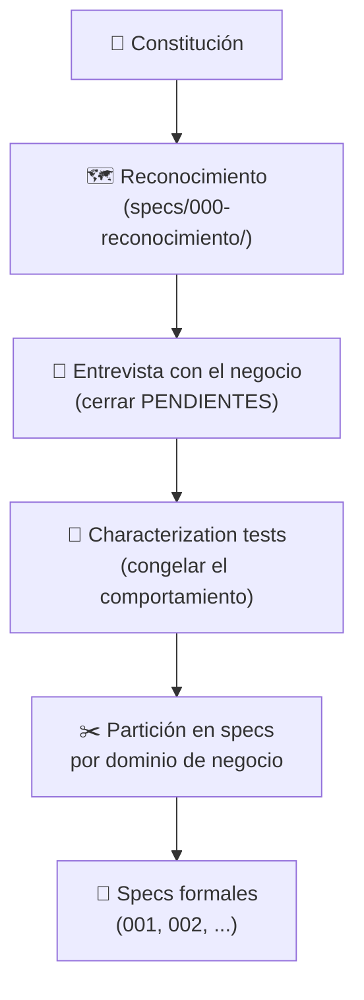

# 🔬 Reverse Spec — Ingeniería Inversa de un Sistema Heredado

> ⬅ Volver al [README principal del repositorio](../README.md)

Esta sección explora el **SDD inverso** (*reverse spec*): en lugar de partir de una idea para escribir la spec y luego el código, se parte de **código ya existente y sin documentación** y se **extrae la especificación** de lo que el sistema *ya hace*. El resultado es un contrato formal que protege el comportamiento actual y sirve de base para una futura modernización.

El proyecto de ejemplo es `invoicelegacy/` (**GesFact**), el sistema de facturación heredado de *Suministros Hidalgo, S.L.*: un monolito Node.js + Express + EJS con SQLite, estilo ES5, con secretos en claro, comentarios con historia de incidentes, un `LEEME.txt` desactualizado y lógica duplicada. Factura dinero real y la gestoría externa cuadra sus importes céntimo a céntimo.

---

## 🤔 ¿Qué problema resuelve?

Modernizar un sistema heredado sin specs es arriesgado:

- **Nadie sabe qué hace realmente:** la documentación (`LEEME.txt`, de 2019) está obsoleta y el conocimiento está en comentarios, en la BD y en la memoria de personas.
- **Los "bugs" pueden ser reglas de negocio:** corregir una rareza puede romper el cuadre con la gestoría.
- **Reescribir a ciegas pierde reglas:** lo que no está documentado no se migra.

La respuesta es una fase previa de **reconocimiento**: documentar y proteger antes de tocar nada.

---

## 🧭 Principios (Constitución del proyecto)

Definidos en `invoicelegacy/.specify/memory/constitution.md` (prompt en [`docs/prompt_constitution.txt`](docs/prompt_constitution.txt)):

1. **El comportamiento actual es sagrado.** Ningún cambio observable sin decisión escrita del negocio, aunque parezca un error.
2. **Evidencia obligatoria.** Toda afirmación cita fichero y líneas, dato real o testimonio con nombre y fecha. Lo no verificado se marca como `SUPOSICIÓN`.
3. **Los hallazgos se registran, no se corrigen.** Bugs y rarezas van al registro de anomalías.
4. **Cero dependencias nuevas y cero refactors.** Los tests usan solo el runner nativo `node:test`.
5. **Todo en español de España.**

---

## 🔄 Flujo de trabajo



Cada paso se ejecuta con un prompt reutilizable guardado en [`docs/`](docs/). Salvo la constitución, todos los artefactos se generan dentro de `invoicelegacy/specs/000-reconocimiento/`:

| Paso | Prompt | Artefacto generado |
| :--- | :--- | :--- |
| Constitución | [`prompt_constitution.txt`](docs/prompt_constitution.txt) | `invoicelegacy/.specify/memory/constitution.md` |
| Mapa del sistema | [`prompt_mapa_sistema.txt`](docs/prompt_mapa_sistema.txt) | `mapa-sistema.md` (módulos, criticidad, dependencias, zonas oscuras) |
| Flujo de factura | [`prompt_flujo_factura.txt`](docs/prompt_flujo_factura.txt) | `flujo-factura.md` (creación manual, remesa mensual, rectificación) |
| Memoria histórica | [`prompt_memoria_historica.txt`](docs/prompt_memoria_historica.txt) | `memoria-historica.md` (incidentes, decisiones, "no tocar") |
| Reglas de negocio | [`prompt_reglas_negocio.txt`](docs/prompt_reglas_negocio.txt) | `reglas-de-negocio.md` (RN-01…RN-55) |
| Contradicciones | [`prompt_contradicciones.txt`](docs/prompt_contradicciones.txt) | `contradiccion-01…10-*.md` + `contradicciones-indice.md` |
| Riesgos y deuda | [`prompt_registro_riesgos.txt`](docs/prompt_registro_riesgos.txt) | `registro-riesgos.md` |
| Anomalías | [`prompt_anomalias.txt`](docs/prompt_anomalias.txt) | `registro-de-anomalias.md` (A-01…A-73) |
| Preparar entrevista | [`prompt_formular_entrevista.txt`](docs/prompt_formular_entrevista.txt) | `entrevista-negocio-simulada.md`, `entrevista-ronda-2-formulario.md` |
| Propagar el acta | [`prompt_entrevista.txt`](docs/prompt_entrevista.txt) | Actualiza anomalías, riesgos y memoria histórica |
| Tests de caracterización | [`prompt_tests_characterization.txt`](docs/prompt_tests_characterization.txt) | `invoicelegacy/test/` + golden master (`npm test`) |
| Partición en specs | [`prompt_propuesta_particion_specs.txt`](docs/prompt_propuesta_particion_specs.txt) | `propuesta-particion-specs.md` (10 specs por dominio; no genera aún las specs) |

> ⚠️ **Precondición de la partición:** la lista `PENDIENTE` del registro de anomalías debería estar vacía antes de particionar. En este ejemplo **no lo está** (30 entradas): la entrevista con el negocio es *simulada*, y una respuesta simulada no cuenta como testigo (la constitución exige una persona identificada, con nombre y fecha). Por eso la propuesta incluye respuestas del «cliente simulado» en un anexo, las anomalías siguen en `PENDIENTE` y las specs resultantes quedan en `Draft`: **no pasan a «aprobada»** hasta que una persona del negocio firme.

---

## 📁 Estructura

```text
5_reverse_spec/
├── docs/                      # Prompts reutilizables de cada paso
└── invoicelegacy/             # GesFact (sistema heredado)
    ├── server.js, db.js, config.js
    ├── routes/ services/ lib/ scripts/ views/ public/
    ├── datos/                 # gesfact.db + volcado MySQL 2018
    ├── test/                  # Characterization tests + golden master (node:test)
    ├── specs/
    │   ├── 000-reconocimiento/        # Artefactos de ingeniería inversa
    │   └── 001-calculo-importes-iva/  # Primera spec formal (spec.md + checklist)
    ├── .agents/summary/       # Base de conocimiento para agentes de IA
    ├── AGENTS.md              # Guía de navegación para agentes
    └── .specify/ .kiro/       # Andamiaje SpecKit / Kiro (fuera de alcance)
```

---

## ✅ Estado actual

- **Reconocimiento** completo en `specs/000-reconocimiento/`.
- **Red de seguridad:** 273 tests de caracterización más un golden master (`test/golden/`), todos en verde; se ejecutan con `npm test` (`node --test test/*.test.js`).
- **Anomalías pendientes:** 30 sin cerrar, a la espera de una persona del negocio identificada.
- **Partición propuesta:** 10 specs por dominio (cálculo de importes, descuentos, numeración, emisión manual, vida de la factura, prorrateo, remesa, informes fiscales, maestros de clientes, operación).
- **Specs formales generadas:** solo `001-calculo-importes-iva` (en `Draft`; pendiente de firma de una persona identificada). Las otras 9 de la propuesta están por generar.

---

## ▶️ Ejecutar GesFact

Requiere Node.js. Las dependencias son `express`, `body-parser`, `ejs` y `sqlite3`.

```bash
cd invoicelegacy
npm install
npm test          # tests de caracterización
npm start         # http://localhost:3000
```

> 💡 Para orientarte, empieza por `invoicelegacy/AGENTS.md` y `invoicelegacy/.agents/summary/index.md`, y después por `specs/000-reconocimiento/mapa-sistema.md`.
