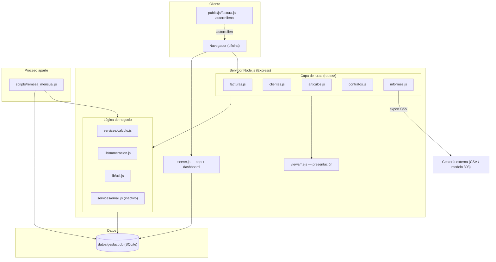
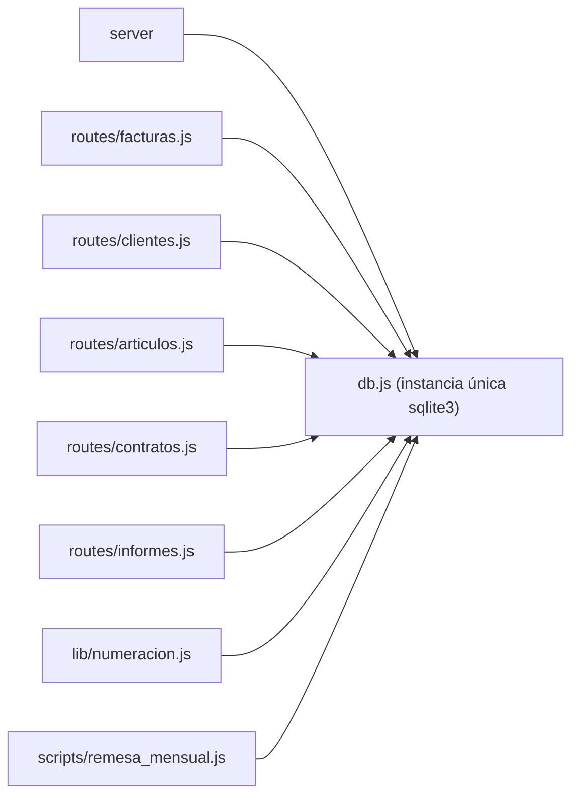
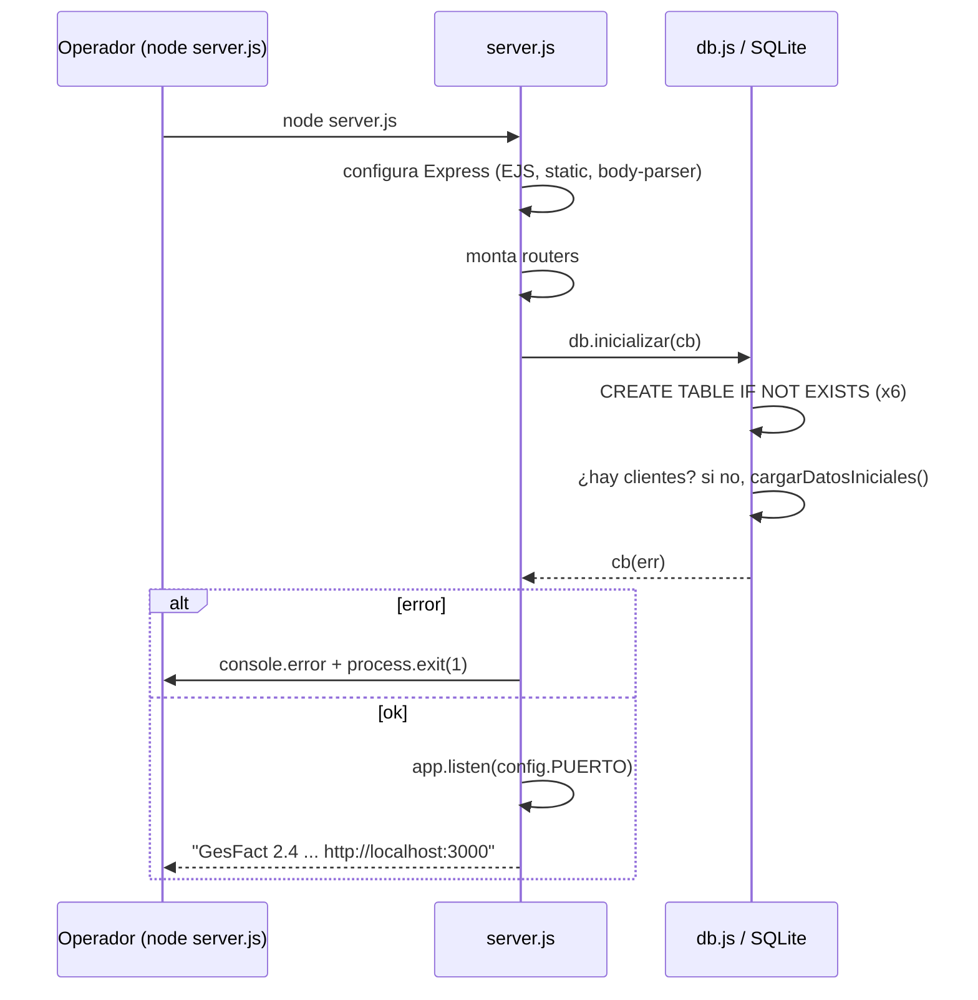

# Arquitectura y patrones de diseño — GesFact

> Describe la arquitectura REAL del sistema con evidencia. No propone rediseños.

## Visión general

GesFact es un **monolito web renderizado en servidor** sobre Node.js + Express,
con persistencia en un fichero SQLite local. Sigue una separación por capas
clásica, informal pero consistente:

## Capas y responsabilidades

| Capa | Ubicación | Responsabilidad | Evidencia |
|------|-----------|-----------------|-----------|
| Arranque / composición | `server.js` | Crea la app Express, configura EJS y estáticos, monta los routers, inicializa la BD y arranca el listener | `server.js:11-55` |
| Enrutado HTTP | `routes/*.js` | Define los endpoints, lee la petición, orquesta negocio+datos, renderiza vista o redirige | cada `routes/*.js` |
| Negocio | `services/calculo.js`, `lib/numeracion.js`, `lib/util.js` | Cálculo de importes, numeración legal, utilidades (redondeo, fechas, formato, NIF) | ver `components.md` |
| Integración | `services/email.js`, export en `routes/informes.js` | Email (desactivado) y exportación a gestoría | `services/email.js`, `routes/informes.js:28-45` |
| Persistencia | `db.js` | Conexión SQLite, creación de esquema, carga de datos semilla | `db.js` |
| Presentación | `views/*.ejs`, `public/` | HTML renderizado en servidor + JS/CSS de cliente | `server.js:15-17` |
| Proceso batch | `scripts/remesa_mensual.js` | Facturación mensual de contratos por CLI | `scripts/remesa_mensual.js` |

## Patrones de diseño observados

### 1. Router modular de Express
Cada entidad de dominio tiene su propio `express.Router()` montado bajo un prefijo
en `server.js:49-53` (`/clientes`, `/articulos`, `/contratos`, `/facturas`,
`/informes`). El dashboard raíz `/` vive directamente en `server.js:19-47`.

### 2. Módulo singleton de base de datos
`db.js` crea **una sola** instancia de `sqlite3.Database` y la exporta como módulo
(`db.js:15`, `module.exports = db`). Todos los módulos comparten esa conexión vía
`require('../db')`. Además expone `db.inicializar` como propiedad del propio objeto
exportado (`db.js:187`).

### 3. Callbacks anidados (estilo "callback hell")
El acceso a datos usa la API de callbacks de `sqlite3`. Las operaciones
dependientes se anidan. Ejemplo extremo: el dashboard encadena cuatro `db.get`
anidados (`server.js:21-44`).

### 4. Separación cálculo puro vs. efectos
`services/calculo.js` es **lógica pura** (sin acceso a BD): recibe líneas y
cliente, devuelve el cálculo. Las rutas y el batch se encargan de leer/escribir en
la BD alrededor de esa función. Esto hace de `calculo.js` el candidato natural a
tests de caracterización.

### 5. Reserva de número con "leer-y-actualizar"
`lib/numeracion.js` reserva el siguiente número leyendo el contador y
actualizándolo (`siguienteNumero` → `reservar`, `numeracion.js:18-45`). No usa
transacción ni bloqueo; el propio código advierte de una colisión histórica
cuando dos personas grababan a la vez (`numeracion.js:11-13`).

## Características transversales (y sus ausencias)

- **Sin autenticación/autorización**: no hay login; se asume red interna de
  oficina. Ninguna ruta comprueba identidad (revisado en los cinco `routes/*.js`).
- **Sin transacciones explícitas**: factura y líneas se insertan por separado. En
  `POST /facturas/nueva` las líneas se insertan **en paralelo** con un contador
  `pendientes` (`facturas.js:76-95`); si una línea falla a mitad, la cabecera ya
  está grabada (el propio comentario reconoce que se arregló a mano en su día,
  `facturas.js:72-74`).
- **Manejo de errores**: por respuesta HTTP directa (`res.status(500).send(...)`)
  en las rutas; en el batch, `console.error` + `process.exit(1)`.
- **Configuración por fichero**: `config.js` se copia a mano al servidor de la
  oficina (`config.js:2-3`); contiene secretos en claro (SMTP, clave de gestoría).
- **Dos rutas de ejecución**: servidor web interactivo y batch mensual. Ambos
  comparten `calculo` y `numeracion`, pero el batch reimplementa el prorrateo (ver
  `workflows.md`).

## Modelo de arranque

