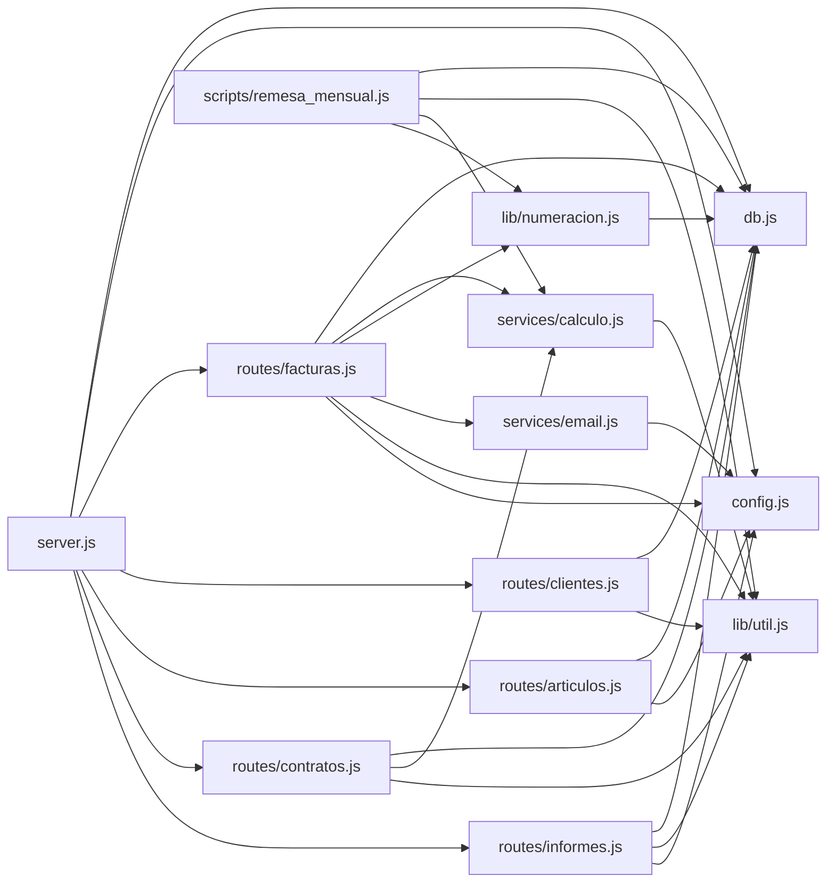

# GesFact — Información general del código

> Sistema HEREDADO de facturación en producción de **Suministros Hidalgo, S.L.**
> Esta documentación describe el comportamiento REAL observado en el código, con
> evidencia (fichero y líneas). No propone cambios: el objetivo es documentar y
> proteger. Ver `.specify/memory/constitution.md`.

## Qué es GesFact

Aplicación web interna de facturación usada en la oficina de Suministros Hidalgo.
Gestiona clientes, artículos, contratos de cuota mensual, facturas (con sus
rectificativas) e informes de IVA y exportación para la gestoría. Factura dinero
real; la gestoría externa depende de sus importes céntimo a céntimo
(`services/calculo.js:1-9`).

Historia (según cabecera de `server.js:5-8`):

- v2.0 (2017): reescritura del GesFact 1.x (Access) en Node.
- v2.2 (2018): paso de ficheros JSON a SQLite.
- v2.3 (2019): informes de IVA y exportación a gestoría.
- v2.4 (2021): script de remesas mensuales.

## Stack tecnológico

| Capa | Tecnología | Evidencia |
|------|-----------|-----------|
| Lenguaje | JavaScript (Node.js, estilo ES5: `var`, callbacks) | todos los `.js` |
| Entorno histórico | Node 8 / LTS | `LEEME.txt` |
| Servidor web | Express 4 | `server.js:9`, `package.json` |
| Parseo de formularios | body-parser (urlencoded) | `server.js:16` |
| Vistas | EJS (renderizado en servidor) | `server.js:15`, carpeta `views/` |
| Base de datos | SQLite 3 (fichero local) | `db.js:7`, `config.js:RUTA_BD` |
| Estáticos | `express.static('public')` | `server.js:17` |
| Ejecución batch | Node script por línea de comandos | `scripts/remesa_mensual.js` |

Dependencias declaradas (`package.json`): `express`, `body-parser`, `ejs`,
`sqlite3`. No hay framework de test ni linter. No hay sistema de build.

## Lenguajes soportados por el análisis

- **Analizado a fondo**: JavaScript de la aplicación (`.js` en raíz, `routes/`,
  `services/`, `lib/`, `scripts/`, `public/js/`).
- **No analizado en profundidad**: plantillas EJS (`views/*.ejs`) y CSS
  (`public/css/estilos.css`) — se mencionan como capa de presentación pero no se
  diseccionan línea a línea. Ver `review_notes.md`.
- **Fuera de alcance (excluido explícitamente)**: el andamiaje de Spec Kit en
  `.specify/` (scripts bash/python de gestión de ramas y commits). No forma parte
  del producto GesFact.

## Estructura de directorios (aplicación GesFact)

```mermaid
graph TD
    ROOT["invoicelegacy/"]
    ROOT --> SERVER["server.js — arranque Express + dashboard"]
    ROOT --> DB["db.js — SQLite: esquema + datos semilla"]
    ROOT --> CONFIG["config.js — empresa, puerto, SMTP, claves"]
    ROOT --> PKG["package.json — dependencias"]
    ROOT --> LEEME["LEEME.txt — notas de instalación/mantenimiento"]

    ROOT --> ROUTES["routes/"]
    ROUTES --> R_FAC["facturas.js"]
    ROUTES --> R_CLI["clientes.js"]
    ROUTES --> R_ART["articulos.js"]
    ROUTES --> R_CON["contratos.js"]
    ROUTES --> R_INF["informes.js"]

    ROOT --> SERVICES["services/"]
    SERVICES --> S_CALC["calculo.js — cálculo de factura"]
    SERVICES --> S_MAIL["email.js — envío (FUERA DE SERVICIO)"]

    ROOT --> LIB["lib/"]
    LIB --> L_NUM["numeracion.js — numeración legal"]
    LIB --> L_UTIL["util.js — utilidades (redondeo, fechas, NIF)"]

    ROOT --> SCRIPTS["scripts/"]
    SCRIPTS --> SC_REM["remesa_mensual.js — batch mensual"]

    ROOT --> VIEWS["views/ — plantillas EJS"]
    ROOT --> PUBLIC["public/ — css y js de cliente"]
    ROOT --> DATOS["datos/ — gesfact.db (SQLite) + volcado MySQL 2018"]
```

## Mapa de dependencias entre módulos

> Observación con evidencia: `scripts/remesa_mensual.js` depende de `calculo` y
> `numeracion`, pero **NO llama a `calculo.calcularProrrateo`**; recalcula el
> prorrateo por su cuenta con `util.diasDelMes` (`remesa_mensual.js:47-54`). Ver
> `workflows.md` y `review_notes.md`.

## Convenciones observadas en el código

- Estilo ES5 uniforme: `var`, funciones nombradas, callbacks anidados de
  `sqlite3`. No hay `async/await` ni promesas.
- Importes monetarios: redondeo a 2 decimales **línea a línea** con
  `util.redondear2` (`lib/util.js:5-7`); no se redondea sobre el total.
- Fechas almacenadas como texto `YYYY-MM-DD` (`lib/util.js:hoy`).
- Importes en pantalla/CSV con formato español: `1.234,50` (`util.formatearImporte`).
- Comentarios en primera persona del equipo (Julian, Roberto, Puri de la
  gestoría) que documentan decisiones de negocio y advertencias. Son fuente de
  **testimonio** según la constitución; se citan con autor y fecha cuando existen.

## Dónde mirar según la pregunta

| Pregunta | Fichero(s) |
|----------|-----------|
| Cómo se calcula una factura / redondeo / recargo / descuento | `services/calculo.js` |
| Cómo se numeran las facturas | `lib/numeracion.js` |
| Esquema de datos | `db.js` (y `data_models.md`) |
| Qué URLs existen | `routes/*.js` (y `interfaces.md`) |
| Facturación mensual automática | `scripts/remesa_mensual.js` |
| Export a la gestoría / informe IVA | `routes/informes.js` |
| Configuración (puerto, empresa, claves) | `config.js` |
