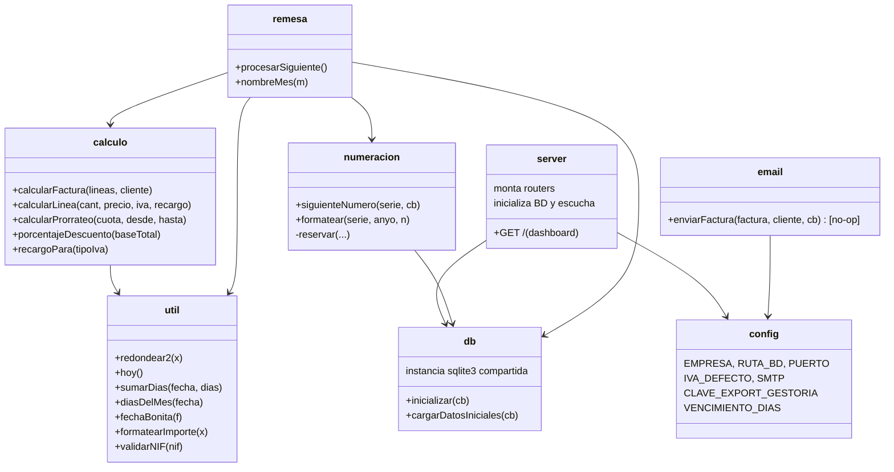

# Componentes y responsabilidades — GesFact

> Detalle de cada componente con su API interna y comportamiento REAL observado.
> Toda afirmación cita fichero y, cuando aporta, función o líneas.

## Mapa de componentes

## services/calculo.js — Cálculo de factura (núcleo crítico)

Lógica pura, sin acceso a BD. Es el componente de mayor riesgo: define los
importes que la gestoría cuadra céntimo a céntimo.

| Función | Entrada | Salida | Comportamiento clave |
|---------|---------|--------|----------------------|
| `recargoPara(tipoIva)` | tipo de IVA | % de recargo de equivalencia | 21→5.2, 10→1.4, 4→0.5; mantiene tipos antiguos (18/16/8/7) "por si hay que reabrir ejercicios del Access" (`calculo.js:17-21`) |
| `calcularLinea(cantidad, precio, tipoIva, conRecargo)` | datos de línea | `{base, cuotaIva, cuotaRecargo}` | **Redondea cada componente a 2 decimales por línea** con `util.redondear2` (`calculo.js:26-35`) |
| `porcentajeDescuento(baseTotal)` | base bruta | 0, 2 o 5 | `>5000`→5%, `>1000`→2% (estricto `>`, no `>=`) (`calculo.js:40-44`) |
| `calcularFactura(lineas, cliente)` | líneas crudas + cliente | factura completa | Suma base bruta, calcula descuento, **aplica el descuento al precio línea a línea** y recalcula; acumula base/iva/recargo y total (`calculo.js:49-91`) |
| `calcularProrrateo(cuota, desde, hasta)` | cuota mensual y rango | importe prorrateado | **Mes = 30 días fijos**: `cuota/30*dias`; recorta a 30 (el día 31 no se cobra) (`calculo.js:97-104`) |

Advertencias documentadas en el propio fichero (testimonio de negocio):

- **No cambiar el redondeo** (Julian, mayo 2019): cambiarlo a redondeo sobre base
  total provocó que la gestoría (Puri) devolviera un trimestre entero
  (`calculo.js:3-8`).
- El descuento se aplica línea a línea "para que la gestoría lo vea desglosado
  igual" (petición de Puri, 2018) (`calculo.js:66-67`).
- El recargo de equivalencia solo se aplica si `cliente.recargo_equivalencia == 1`
  (`calculo.js:50`).

> ANOMALÍA de duplicación de lógica (registrada en `review_notes.md`): el prorrateo
> "oficial" vive aquí con 30 días fijos, pero `scripts/remesa_mensual.js` NO usa
> esta función y prorratea con los días reales del mes.

## lib/numeracion.js — Numeración legal

Garantiza numeración correlativa por serie y año. Requisito legal: sin huecos; las
facturas no se borran (`numeracion.js:3-9`).

| Función | Descripción | Evidencia |
|---------|-------------|-----------|
| `siguienteNumero(serie, cb)` | Lee el contador `(serie, año actual)`; si no existe, lo crea a 0; reserva el siguiente | `numeracion.js:16-30` |
| `reservar(serie, anyo, ultimo, cb)` | `UPDATE contadores SET ultimo = ultimo+1`, devuelve el número formateado | `numeracion.js:32-38` |
| `formatear(serie, anyo, n)` | Formato `SERIE-AAAA-NNNNNN` (6 dígitos con ceros) p.ej. `FA-2026-000123` | `numeracion.js:40-44` |

- El año se toma de `new Date().getFullYear()` (`numeracion.js:17`): la numeración
  depende de la fecha del sistema, no de la fecha de la factura.
- Sin transacción/bloqueo; colisión histórica reconocida (`numeracion.js:11-13`).

## lib/util.js — Utilidades transversales

| Función | Propósito | Nota de comportamiento |
|---------|-----------|------------------------|
| `redondear2(x)` | Redondeo a 2 decimales | `Math.round(x*100)/100` (`util.js:5-7`). Crítico; no tocar |
| `hoy()` | Fecha de hoy `YYYY-MM-DD` | `util.js:10-15` |
| `sumarDias(fecha, dias)` | Suma días a una fecha | Usa milisegundos; TODO reconoce un desfase de 1 día no reproducido, posiblemente por cambio de hora (`util.js:19-26`) |
| `fechaBonita(f)` | `YYYY-MM-DD` → `DD/MM/YYYY` | `util.js:29-33` |
| `diasDelMes(fecha)` | Días del mes de una fecha | `new Date(a, m, 0).getDate()` (`util.js:36-39`) |
| `validarNIF(nif)` | Validación de NIF/CIF | **Solo comprueba longitud == 9**, no la letra; TODO lo reconoce (`util.js:43-47`) |
| `formatearImporte(x)` | Número → `1.234,50` (formato ES) | Maneja negativos y NaN→`0,00` (`util.js:50-57`) |

## services/email.js — Envío de facturas (INACTIVO)

- `enviarFactura(factura, cliente, cb)` está **fuera de servicio desde 2022**: el
  cuerpo con `nodemailer` está comentado; solo hace `console.log` de aviso y llama
  a `cb(null)` (`email.js:16-29`).
- `nodemailer` fue desinstalado en 2023 (`email.js:13`). Las facturas se envían a
  mano desde el Outlook de Marga (`email.js:4-7`).
- Se sigue invocando desde `POST /facturas/nueva` (`facturas.js:88`), pero es un
  no-op que no bloquea el alta.

## db.js — Persistencia

- Crea/abre `datos/gesfact.db` (crea la carpeta si falta, `db.js:11-15`).
- `inicializar(cb)`: crea las 6 tablas con `IF NOT EXISTS` dentro de
  `db.serialize` y, si no hay clientes, llama a `cargarDatosIniciales`
  (`db.js:17-83`).
- `cargarDatosIniciales(cb)`: siembra clientes, artículos, contratos y un histórico
  de facturas/líneas de 2026, y fija los contadores `FA=108` y `RE=1`
  (`db.js:87-184`). Comentario: "no tocar, administración los usa de referencia"
  (`db.js:85-86`).
- Ver esquema detallado en `data_models.md`.

## config.js — Configuración

Objeto exportado con: `EMPRESA` (datos fiscales que salen en factura), `RUTA_BD`
(`./datos/gesfact.db`), `PUERTO` (3000), `IVA_DEFECTO` (21), `SMTP` (servidor Arsys,
**credenciales en claro**, roto desde 2022), `CLAVE_EXPORT_GESTORIA`
(`SH-CONTA-7731`, "no cambiar") y `VENCIMIENTO_DIAS` (30). El fichero se copia a mano
al servidor; "NO RENOMBRAR" (`config.js:2-3`).

## scripts/remesa_mensual.js — Facturación mensual (batch)

- Uso: `node scripts/remesa_mensual.js YYYY-MM` (`remesa_mensual.js:4`).
- Selecciona contratos activos en el mes (alta ≤ último día y baja nula o ≥ primer
  día) (`remesa_mensual.js:30-33`).
- Para cada contrato calcula el importe del mes; si alta/baja caen dentro del mes,
  prorratea **por días reales del mes** (`remesa_mensual.js:47-54`), emite una
  factura serie `FA` con una línea y vencimiento = fecha + `dias_pago` del cliente
  o 30 (`remesa_mensual.js:62-63`).
- `procesarSiguiente()` recorre los contratos de forma recursiva por callbacks;
  `nombreMes(m)` traduce el mes a nombre en español (`remesa_mensual.js:79-84`).

## public/js/factura.js — Autorrelleno en cliente

Único JavaScript de navegador: al elegir un artículo del `datalist`, copia su
precio y tipo de IVA a la fila del formulario (`factura.js:3-16`). Añadido por
Roberto en 2021.
