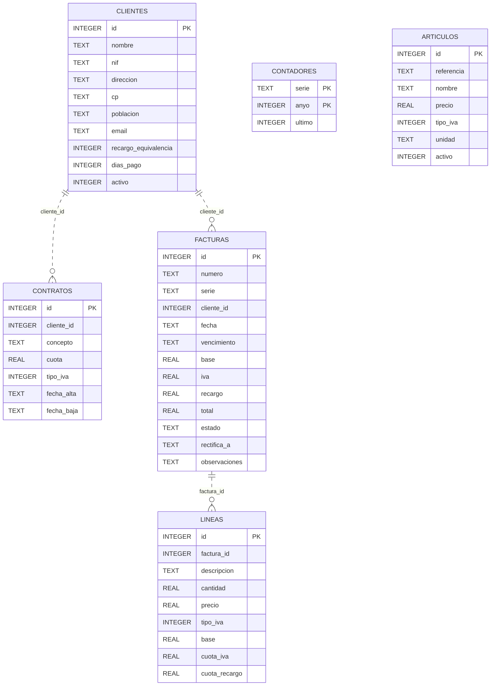
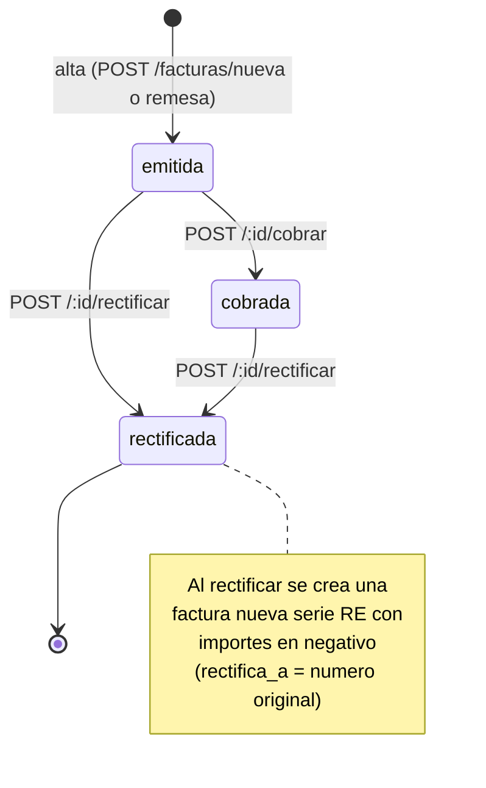

# Modelos de datos — GesFact

> Esquema REAL de la base de datos SQLite, extraído de `db.js:17-83`. Los tipos y
> comentarios reflejan el código tal cual.

## Resumen

- Motor: SQLite 3, fichero `datos/gesfact.db` (`config.js:RUTA_BD`).
- 6 tablas, creadas con `CREATE TABLE IF NOT EXISTS` en `db.inicializar`.
- Sin claves foráneas declaradas: las relaciones son por convención (`cliente_id`,
  `factura_id`) pero **no hay `FOREIGN KEY` ni `PRAGMA foreign_keys`** en el
  esquema. Integridad referencial no forzada por la BD.
- Fechas como texto `YYYY-MM-DD`. Importes como `REAL`, ya redondeados a 2
  decimales por la capa de negocio antes de persistir.

## Diagrama entidad-relación (relaciones por convención)

> `ARTICULOS` no tiene relación declarada con `LINEAS`: al crear una factura, los
> datos del artículo se **copian** a la línea (descripción, precio, IVA); no se
> guarda referencia al artículo (`facturas.js:52-65`). Las líneas son autónomas.

## Tablas en detalle

### clientes (`db.js:19-30`)
| Columna | Tipo | Notas |
|---------|------|-------|
| id | INTEGER PK AUTOINCREMENT | |
| nombre | TEXT NOT NULL | |
| nif | TEXT | Validado solo por longitud al dar de alta |
| direccion, cp, poblacion, email | TEXT | |
| recargo_equivalencia | INTEGER DEFAULT 0 | `1` = minorista en recargo |
| dias_pago | INTEGER | `NULL` → usa `config.VENCIMIENTO_DIAS` |
| activo | INTEGER DEFAULT 1 | Baja lógica (`0`) |

### articulos (`db.js:32-39`)
| Columna | Tipo | Notas |
|---------|------|-------|
| id | INTEGER PK AUTOINCREMENT | |
| referencia | TEXT | p.ej. `MEN-0012` |
| nombre | TEXT NOT NULL | |
| precio | REAL NOT NULL | Precio unitario **sin** IVA |
| tipo_iva | INTEGER NOT NULL | 21 / 10 / 4 |
| unidad | TEXT DEFAULT 'ud' | ud, kg, caja, saco... |
| activo | INTEGER DEFAULT 1 | Baja lógica |

### contratos (`db.js:42-49`)
Cuotas mensuales (alquileres, mantenimientos).
| Columna | Tipo | Notas |
|---------|------|-------|
| id | INTEGER PK AUTOINCREMENT | |
| cliente_id | INTEGER NOT NULL | → clientes.id (por convención) |
| concepto | TEXT NOT NULL | |
| cuota | REAL NOT NULL | Cuota mensual sin IVA |
| tipo_iva | INTEGER NOT NULL DEFAULT 21 | |
| fecha_alta | TEXT NOT NULL | `YYYY-MM-DD` |
| fecha_baja | TEXT | `NULL` = sigue activo |

### facturas (`db.js:51-64`)
| Columna | Tipo | Notas |
|---------|------|-------|
| id | INTEGER PK AUTOINCREMENT | |
| numero | TEXT NOT NULL | `FA-2026-000123` |
| serie | TEXT NOT NULL DEFAULT 'FA' | `FA` (ordinaria) / `RE` (rectificativa) |
| cliente_id | INTEGER NOT NULL | → clientes.id |
| fecha | TEXT NOT NULL | `YYYY-MM-DD` |
| vencimiento | TEXT | `NULL` en rectificativas |
| base, iva, recargo, total | REAL | `recargo` DEFAULT 0; negativos en rectificativas |
| estado | TEXT NOT NULL DEFAULT 'emitida' | `emitida` / `cobrada` / `rectificada` |
| rectifica_a | TEXT | Número de la factura rectificada |
| observaciones | TEXT | |

Estados y transiciones:

> `POST /:id/cobrar` solo actúa si la factura está `emitida` (`facturas.js:117`).
> `POST /:id/rectificar` rechaza rectificar una `RE` o algo ya `rectificada`
> (`facturas.js:132-133`), pero **sí permite** rectificar una `cobrada` (no lo
> impide).

### lineas (`db.js:66-75`)
| Columna | Tipo | Notas |
|---------|------|-------|
| id | INTEGER PK AUTOINCREMENT | |
| factura_id | INTEGER NOT NULL | → facturas.id |
| descripcion | TEXT NOT NULL | |
| cantidad | REAL NOT NULL | Negativa en rectificativas |
| precio | REAL NOT NULL | Precio aplicado (puede llevar descuento ya aplicado) |
| tipo_iva | INTEGER NOT NULL | |
| base | REAL NOT NULL | **Ya redondeada** (ver `calculo.js`) |
| cuota_iva | REAL NOT NULL | |
| cuota_recargo | REAL NOT NULL DEFAULT 0 | |

> El informe de IVA suma **desde `lineas`** por `tipo_iva`, no desde cabeceras, para
> tener el desglose por tipo; las rectificativas cuadran solas por su signo negativo
> (`informes.js:20-24`).

### contadores (`db.js:78-82`)
Numeración correlativa por serie y año.
| Columna | Tipo | Notas |
|---------|------|-------|
| serie | TEXT NOT NULL | parte de PK |
| anyo | INTEGER NOT NULL | parte de PK |
| ultimo | INTEGER NOT NULL | Último número emitido |
| | | PRIMARY KEY (serie, anyo) |

## Datos semilla (`db.js:87-184`)

Si no hay clientes, `cargarDatosIniciales` inserta un conjunto de referencia que
"administración usa" (`db.js:85-86`): 6 clientes, 8 artículos, 4 contratos y un
histórico de facturas de 2026 (series `FA` y una `RE`), fijando contadores
`FA=108` y `RE=1`. Entre el histórico hay casos didácticos citados en comentarios:

- `FA-2026-000103`: base de 1000,00 € exactos **sin** descuento (el descuento es
  con `>1000`, no `>=`) (`db.js:119`).
- `FA-2026-000106` → `RE-2026-000001` → `FA-2026-000107`: ciclo de error de cuota
  duplicada, rectificación espejo y refacturación (`db.js:140-160`).
- `FA-2026-000105`: descuento por volumen del 2 % aplicado (`db.js:131`).

> Estos datos semilla son valiosos como **casos de caracterización**: fijan
> resultados numéricos esperados que la gestoría ha dado por buenos.
