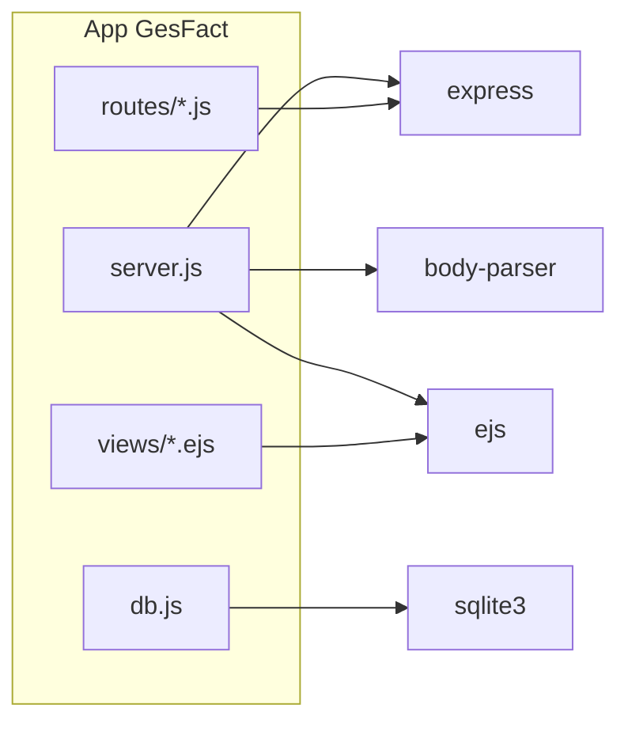

# Dependencias externas y su uso — GesFact

> Dependencias declaradas y de dónde se usan en el código, con evidencia. La
> constitución prohíbe añadir o cambiar dependencias en esta fase
> (`.specify/memory/constitution.md`, Principio IV).

## Dependencias de producción (`package.json`)

| Paquete | Para qué se usa | Dónde (evidencia) |
|---------|-----------------|-------------------|
| `express` | Framework web: app, routers, estáticos | `server.js:9-17`, `routes/*.js` |
| `body-parser` | Parseo de formularios `urlencoded` | `server.js:16` |
| `ejs` | Motor de plantillas (render en servidor) | `server.js:15`, `views/*.ejs` |
| `sqlite3` | Driver de la base de datos SQLite | `db.js:7,15` |

No hay dependencias de desarrollo declaradas: ni test runner, ni linter, ni
formateador, ni herramienta de build. El único script npm es
`start: node server.js` (`package.json`).

## Grafo de uso

## Dependencia retirada

- `nodemailer`: estaba en `services/email.js` para el envío SMTP. **Desinstalado en
  2023** por un aviso de seguridad; el `require` y el cuerpo están comentados
  (`email.js:13-29`). No figura en `package.json`. El envío de correo quedó fuera de
  servicio desde 2022 (Arsys). Reactivarlo exigiría reinstalar la dependencia, lo
  cual está **vetado en esta fase** y requeriría decisión del negocio.

## Dependencias del entorno (no son paquetes npm)

| Elemento | Uso | Evidencia |
|----------|-----|-----------|
| Node.js (Node 8 / LTS histórico) | Ejecución de la app y del batch | `LEEME.txt` |
| Fichero SQLite `datos/gesfact.db` | Persistencia; copia manual a pendrive los viernes | `config.js:RUTA_BD`, `LEEME.txt` |
| `config.js` copiado a mano al servidor | Configuración de la instalación de oficina | `config.js:2-3` |
| Gestoría externa (Contaplus / modelo 303) | Consume el CSV y el resumen de IVA | `routes/informes.js`, `config.js:CLAVE_EXPORT_GESTORIA` |
| Servidor SMTP de Arsys | Envío de correo (inactivo desde 2022) | `config.js:SMTP`, `email.js` |

## Dependencias para tests de caracterización (fase actual)

Según la constitución (Principio IV), los tests de caracterización deben usar
**exclusivamente** el runner nativo de Node: `node:test` y `node:assert`. No se
añade ningún framework externo. Candidatos naturales a caracterizar sin tocar la
BD: las funciones puras de `services/calculo.js` y `lib/util.js`, y el formateo de
`lib/numeracion.js:formatear`.

## Riesgos relacionados con dependencias

- **Secretos en el repositorio**: `config.js` contiene credenciales SMTP en claro y
  la clave de la gestoría (`config.js:SMTP`, `CLAVE_EXPORT_GESTORIA`). Registrado en
  `review_notes.md`; no se modifica en esta fase, pero debe conocerse al manipular
  el fichero.
- **Versiones antiguas**: el `LEEME.txt` apunta a Node 8; `package.json` declara
  rangos `^` modernos de las librerías. Posible desajuste entre entorno histórico
  documentado y versiones instaladas. No se resuelve aquí (Principio IV).
- **Migración MySQL pendiente**: existe `datos/migracion_mysql_2018.sql` pero el
  sistema sigue en SQLite (`LEEME.txt`). Fuera de alcance.
