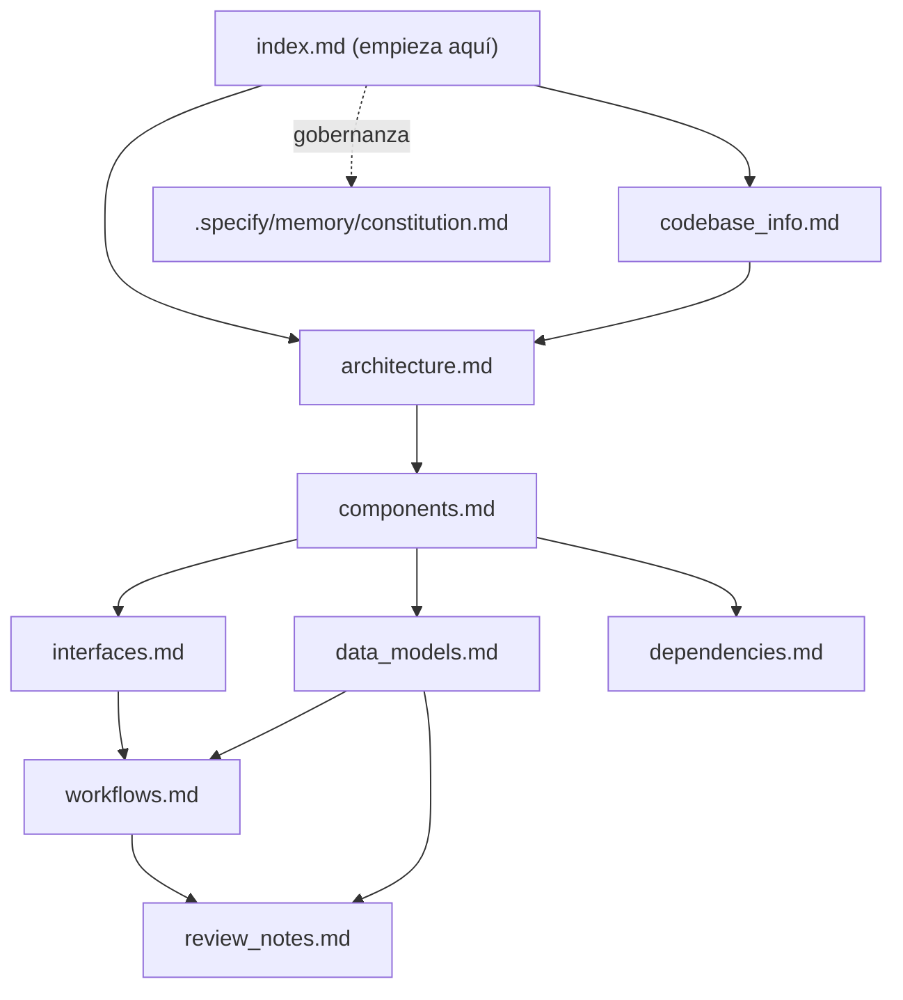

# Índice de la base de conocimiento — GesFact

> **Fichero principal de contexto para asistentes de IA.** Resume qué contiene cada
> documento de `.agents/summary/` y a cuál acudir según la pregunta. Carga este
> fichero primero; abre los demás solo cuando necesites el detalle.

## Instrucciones para asistentes de IA

1. **Sistema HEREDADO en producción.** GesFact factura dinero real de Suministros
   Hidalgo, S.L. La gestoría externa cuadra sus importes céntimo a céntimo.
2. **Lee la constitución antes de proponer cambios**:
   `.specify/memory/constitution.md`. Reglas no negociables: el comportamiento
   actual es sagrado; evidencia obligatoria (fichero/líneas, dato real o testimonio
   con nombre y fecha); los hallazgos se registran, no se corrigen; cero
   dependencias nuevas y cero refactors; todo en español de España.
3. **Toda la documentación cita evidencia** en formato `fichero:líneas`. Si amplías
   la documentación, mantén esa norma y marca lo no verificado como SUPOSICIÓN.
4. **Alcance**: solo la aplicación GesFact. El andamiaje de Spec Kit (`.specify/`)
   está excluido deliberadamente.
5. **Para preguntas de cálculo o numeración**, prioriza `components.md` y
   `workflows.md`, y verifica siempre contra el código citado.

## Tabla de contenidos

| Documento | Para qué sirve | Consúltalo cuando… |
|-----------|----------------|--------------------|
| [`codebase_info.md`](codebase_info.md) | Stack, estructura de directorios, convenciones, mapa de módulos | Necesitas una visión general o ubicar un fichero |
| [`architecture.md`](architecture.md) | Capas, patrones de diseño, arranque, ausencias (auth, transacciones) | Preguntas sobre cómo encaja todo o por qué está estructurado así |
| [`components.md`](components.md) | API interna y comportamiento de cada módulo (calculo, numeracion, util, email, db, config, remesa) | Preguntas sobre una función concreta o su regla de negocio |
| [`interfaces.md`](interfaces.md) | Endpoints HTTP (parámetros, comportamiento), APIs de módulo, integraciones | Preguntas sobre URLs, formularios, CSV de gestoría o email |
| [`data_models.md`](data_models.md) | Esquema SQLite (6 tablas), ER, estados de factura, datos semilla | Preguntas sobre tablas, columnas, relaciones o datos de ejemplo |
| [`workflows.md`](workflows.md) | Flujos: alta de factura, cálculo, rectificación, remesa mensual, numeración, cierre de IVA | Preguntas sobre un proceso de principio a fin |
| [`dependencies.md`](dependencies.md) | Dependencias npm y de entorno, paquete retirado, riesgos | Preguntas sobre librerías, versiones o secretos |
| [`review_notes.md`](review_notes.md) | Hallazgos, anomalías, rarezas, huecos de documentación y recomendaciones | Buscas problemas conocidos o límites de esta documentación |

## Mapa de relaciones entre documentos

## Guía rápida pregunta → documento

| Pregunta típica | Documento(s) |
|-----------------|--------------|
| "¿Cómo se redondea / calcula el IVA / el recargo / el descuento?" | `components.md` (calculo.js) + `workflows.md` (flujo 2) |
| "¿Por qué dos facturas tienen prorrateo distinto?" | `workflows.md` (flujo 4, anomalía) + `review_notes.md` |
| "¿Qué endpoints hay para facturas?" | `interfaces.md` |
| "¿Qué columnas tiene la tabla facturas?" | `data_models.md` |
| "¿Cómo se numera una factura?" | `components.md` (numeracion.js) + `workflows.md` (flujo 5) |
| "¿Cómo se exporta a la gestoría?" | `interfaces.md` + `workflows.md` (flujo 6) |
| "¿Funciona el envío por email?" | `components.md` (email.js) + `dependencies.md` |
| "¿Qué librerías usa?" | `dependencies.md` |
| "¿Qué problemas conocidos hay?" | `review_notes.md` |

## Ejemplos de consultas efectivas

- "Según la documentación, ¿qué pasa si grabo una factura con base de 1000,00 €
  exactos?" → `components.md`/`workflows.md`: no hay descuento (comparación `>`,
  caso `FA-2026-000103`).
- "¿Dónde está el riesgo de que la remesa mensual y la baja de contrato den
  importes distintos?" → `workflows.md` flujo 4 + `review_notes.md` (doble
  prorrateo: 30 días fijos vs. días reales).
- "¿Qué debo tener en cuenta antes de tocar `config.js`?" → `dependencies.md` y
  `components.md`: contiene secretos en claro y se copia a mano al servidor; "NO
  RENOMBRAR".

## Resumen de hallazgos destacados (detalle en `review_notes.md`)

- Doble lógica de prorrateo (30 días fijos vs. días reales del mes).
- Inserción de líneas de factura sin transacción (riesgo de factura incompleta).
- Numeración sin bloqueo (colisión histórica reconocida).
- Validación de NIF solo por longitud.
- Filtro de trimestre de IVA con día `-31` para todos los meses.
- Secretos en claro en `config.js`.
- Envío de email fuera de servicio desde 2022.
