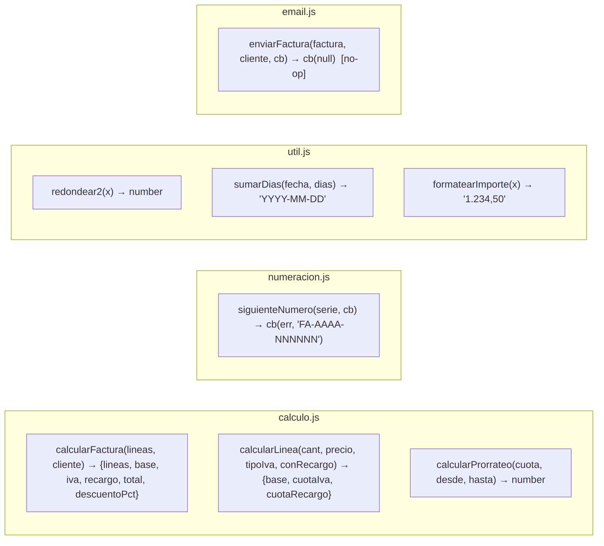
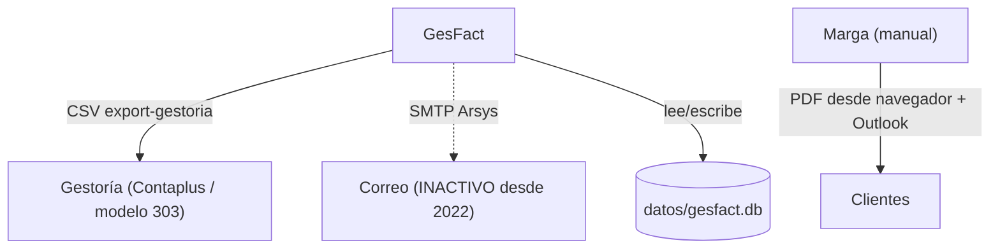

# Interfaces, APIs y puntos de integración — GesFact

> Catálogo de endpoints HTTP, APIs internas de módulos y puntos de integración
> externa. Comportamiento REAL observado, con evidencia.

## Interfaz HTTP

Todas las respuestas son HTML renderizado con EJS, salvo el CSV de exportación. No
hay API JSON ni autenticación. Los formularios usan `application/x-www-form-urlencoded`.

### Dashboard

| Método | Ruta | Descripción | Evidencia |
|--------|------|-------------|-----------|
| GET | `/` | Panel con 4 cifras: nº facturas, facturas emitidas (pendientes), importe pendiente (solo serie `FA` en estado `emitida`), nº clientes activos | `server.js:19-47` |

### Facturas (`/facturas`)

| Método | Ruta | Parámetros | Descripción | Evidencia |
|--------|------|-----------|-------------|-----------|
| GET | `/facturas` | query `estado` (opcional) | Listado ordenado por fecha desc; filtra por estado si se indica | `facturas.js:14-28` |
| GET | `/facturas/nueva` | — | Formulario: clientes y artículos activos | `facturas.js:31-39` |
| POST | `/facturas/nueva` | body: `cliente_id`, `fecha`, `obs`, arrays `desc[]`, `cant[]`, `precio[]`, `iva[]` | Crea factura serie `FA` + líneas; numera; calcula vencimiento; invoca email (no-op); redirige al detalle | `facturas.js:43-100` |
| GET | `/facturas/:id` | path `id` | Detalle / vista imprimible (cabecera + líneas + datos empresa) | `facturas.js:103-113` |
| POST | `/facturas/:id/cobrar` | path `id` | Pasa `emitida` → `cobrada` (solo si está `emitida`) | `facturas.js:116-121` |
| POST | `/facturas/:id/rectificar` | path `id`, body `motivo` | Crea rectificativa serie `RE` espejo en negativo; original → `rectificada` | `facturas.js:124-163` |

Notas de comportamiento (con evidencia):

- `POST /nueva` convierte comas decimales a punto antes de `parseFloat`
  (`facturas.js:60-61`); descarta filas sin descripción (`facturas.js:58`); exige al
  menos una línea (`facturas.js:66`).
- El vencimiento usa `cliente.dias_pago` o `config.VENCIMIENTO_DIAS` (30)
  (`facturas.js:69-70`).
- Las líneas se insertan **en paralelo** sin transacción (`facturas.js:76-95`).
- `POST /rectificar` **no recalcula**: invierte signos de cabecera y líneas
  ("espejo exacto", Puri); rechaza rectificar algo ya rectificado o una `RE`
  (`facturas.js:131-133`).

### Clientes (`/clientes`)

| Método | Ruta | Parámetros | Descripción | Evidencia |
|--------|------|-----------|-------------|-----------|
| GET | `/clientes` | query `aviso` | Listado alfabético; muestra aviso si viene | `clientes.js:7-12` |
| POST | `/clientes/nuevo` | body: `nombre`(req), `nif`, `direccion`, `cp`, `poblacion`, `email`, `recargo_equivalencia`, `dias_pago` | Alta; valida presencia de nombre y NIF por longitud; redirige con aviso si falla | `clientes.js:14-30` |
| POST | `/clientes/:id/baja` | path `id` | Baja lógica: `activo = 0` (no borra) | `clientes.js:32-37` |

### Artículos (`/articulos`)

| Método | Ruta | Parámetros | Descripción | Evidencia |
|--------|------|-----------|-------------|-----------|
| GET | `/articulos` | — | Listado por referencia | `articulos.js:7-12` |
| POST | `/articulos/nuevo` | body: `referencia`, `nombre`, `precio`, `tipo_iva`, `unidad` | Alta; IVA por defecto `config.IVA_DEFECTO` (21); unidad por defecto `ud`; precio admite coma decimal | `articulos.js:14-24` |
| POST | `/articulos/:id/baja` | path `id` | Baja lógica: `activo = 0` | `articulos.js:26-31` |

### Contratos (`/contratos`)

| Método | Ruta | Parámetros | Descripción | Evidencia |
|--------|------|-----------|-------------|-----------|
| GET | `/contratos` | — | Listado con nombre de cliente | `contratos.js:8-13` |
| POST | `/contratos/nuevo` | body: `cliente_id`, `concepto`, `cuota`, `tipo_iva`(def. 21), `fecha_alta`(def. hoy) | Alta de contrato de cuota mensual | `contratos.js:15-24` |
| POST | `/contratos/:id/baja` | path `id`, body `fecha_baja` | Fija `fecha_baja` y redirige con `?prorrateo=` del último mes calculado con `calcularProrrateo` (30 días fijos); la factura del prorrateo la emite administración a mano | `contratos.js:29-41` |

### Informes (`/informes`)

| Método | Ruta | Parámetros | Descripción | Evidencia |
|--------|------|-----------|-------------|-----------|
| GET | `/informes` | — | Pantalla de informes (año actual) | `informes.js:8-10` |
| GET | `/informes/iva` | query `anyo`, `trimestre` | Resumen de IVA del trimestre agrupado por `tipo_iva`, sumando desde `lineas` (las rectificativas restan por su signo) | `informes.js:13-26` |
| GET | `/informes/export-gestoria` | query `anyo` | CSV para la gestoría | `informes.js:29-45` |

Formato del CSV de exportación (acordado con Puri, 2019 — `informes.js:28`):

- Separador `;`, codificación UTF-8, saltos `\r\n`.
- Primera línea: `CLAVE;<config.CLAVE_EXPORT_GESTORIA>`.
- Segunda línea: cabeceras `NUMERO;FECHA;CLIENTE;NIF;BASE;IVA;RECARGO;TOTAL;ESTADO`.
- Importes con formato español (coma decimal) vía `util.formatearImporte`; fecha
  `DD/MM/YYYY` vía `util.fechaBonita`.
- Filtra por `f.fecha LIKE '<anyo>-%'`.

## APIs internas de módulos (contratos de función)

Contratos destacados:

- `calculo.calcularFactura(lineas, cliente)`: `lineas` = `[{descripcion, cantidad,
  precio, tipoIva}]`; `cliente` necesita `recargo_equivalencia`. Devuelve objeto con
  líneas calculadas y totales (`calculo.js:49-91`).
- `numeracion.siguienteNumero(serie, cb)`: callback `(err, numero)` con el número
  ya formateado y reservado (`numeracion.js:16`).
- `email.enviarFactura(...)`: firma de callback intacta pero sin efecto real
  (`email.js:16-29`).

## Puntos de integración externa

| Integración | Estado | Evidencia |
|-------------|--------|-----------|
| Exportación a gestoría (CSV) | **Activa**, formato fijo con clave | `informes.js:29-45`, `config.js:CLAVE_EXPORT_GESTORIA` |
| Resumen de IVA (base del modelo 303, lo termina la gestoría) | Activa | `informes.js:13-26` |
| Envío de factura por email (SMTP Arsys) | **Inactivo** desde 2022; envío manual | `services/email.js`, `config.js:SMTP` |
| Base de datos SQLite | Activa; copia manual a pendrive los viernes (Marga) | `db.js`, `LEEME.txt` |
| Migración a MySQL | **Pendiente** (volcado de 2018 sin aplicar) | `datos/migracion_mysql_2018.sql`, `LEEME.txt` |
