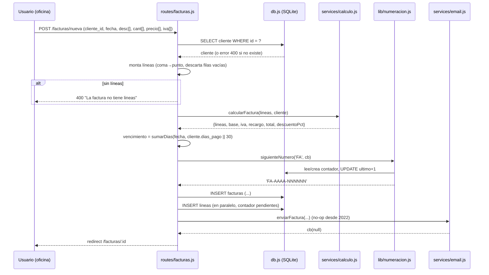
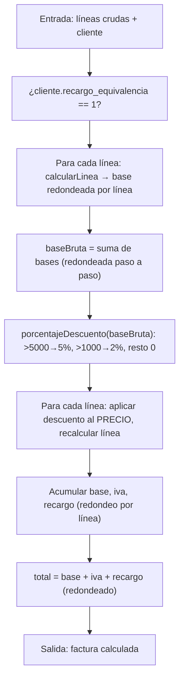
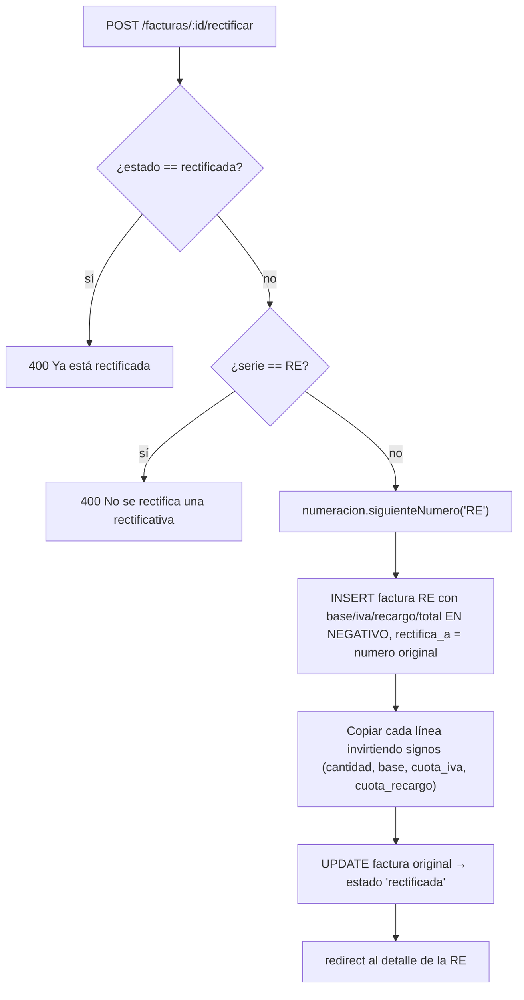
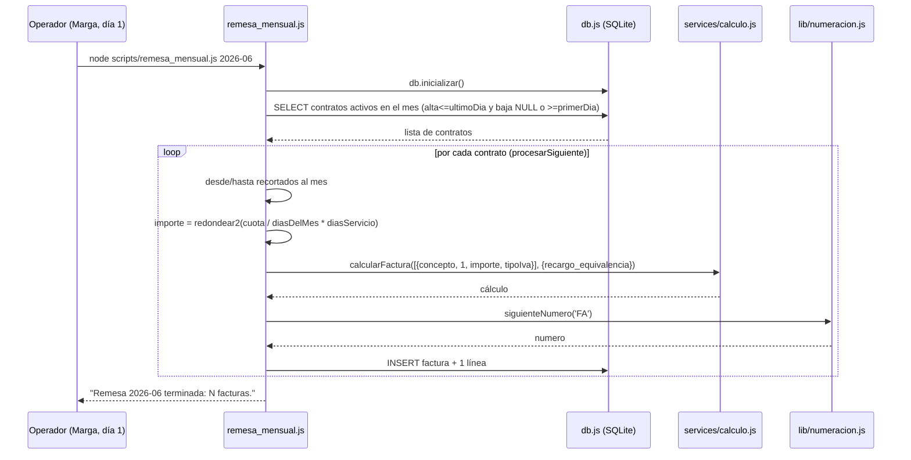
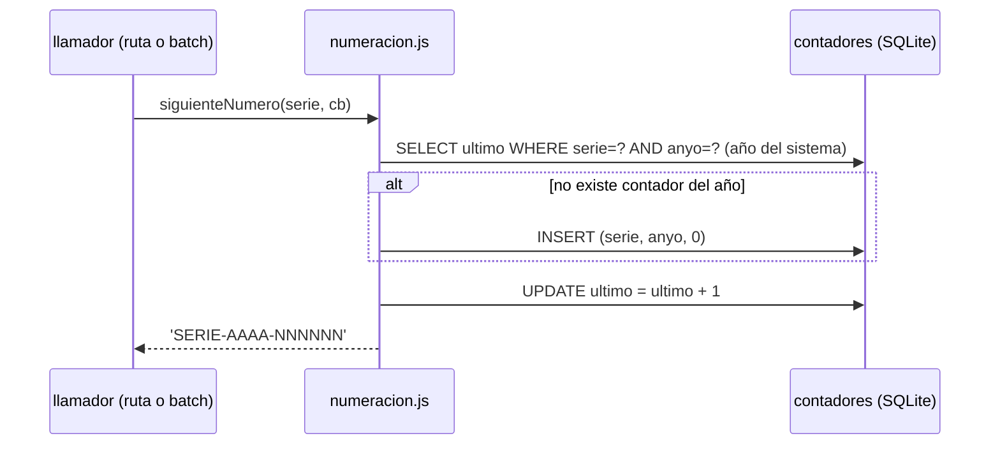
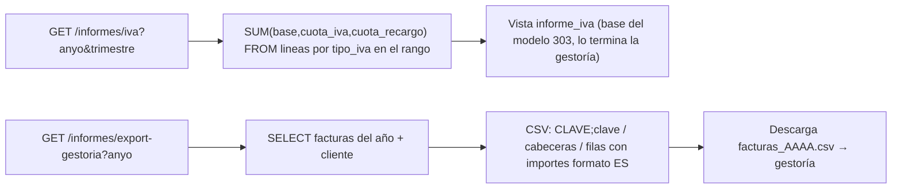

# Flujos y procesos clave — GesFact

> Procesos de negocio tal como los ejecuta el código, con evidencia. No se propone
> cambiarlos.

## 1. Alta de factura manual (POST /facturas/nueva)



Puntos sensibles (con evidencia):

- Si el descuento por volumen aplica, se anota en observaciones automáticamente
  (`facturas.js:71-73`).
- Las líneas se insertan **sin transacción**, en paralelo; si una falla con la
  cabecera ya grabada, queda una factura incompleta (`facturas.js:76-95`).
- El email es un no-op; el alta no depende de él (`facturas.js:88`,
  `email.js:16-29`).

## 2. Cálculo de una factura (services/calculo.js)



Reglas con evidencia:

- Redondeo a 2 decimales **en cada componente de cada línea** (`calculo.js:26-35`);
  nunca sobre el total global. **No cambiar** (incidente gestoría mayo 2019,
  `calculo.js:3-8`).
- Descuento con comparación estricta `>` (1000,00 € exactos no descuenta;
  `calculo.js:40-44`, caso `FA-2026-000103`).
- Recargo de equivalencia según el tipo de IVA vía `recargoPara` (`calculo.js:12-22`).

## 3. Rectificación de factura (POST /facturas/:id/rectificar)



- **No recalcula**: es un espejo exacto en negativo (Puri; `facturas.js:124-129`).
- La RE se crea con `fecha = hoy()` y `vencimiento = null` (`facturas.js:149`).

## 4. Remesa mensual de contratos (batch) — scripts/remesa_mensual.js



Selección de contratos y prorrateo (`remesa_mensual.js:30-54`):

- Activo en el mes = `fecha_alta <= ultimoDia AND (fecha_baja IS NULL OR
  fecha_baja >= primerDia)`.
- Si alta/baja caen dentro del mes, se prorratea; el sufijo de la línea indica
  "(N dias)" o "(mes año)".

> **ANOMALÍA CLAVE — dos prorrateos distintos** (ver `review_notes.md`):
>
> ```mermaid
> graph TB
>     subgraph "Prorrateo 'oficial' (30 días fijos)"
>         P1["services/calculo.js: calcularProrrateo"]
>         P1 --> U1["POST /contratos/:id/baja → ?prorrateo="]
>     end
>     subgraph "Prorrateo de la remesa (días reales del mes)"
>         P2["scripts/remesa_mensual.js (inline, util.diasDelMes)"]
>     end
> ```
>
> La función `calcularProrrateo` usa `cuota/30*dias` (`calculo.js:97-104`) y la usa
> la baja de contrato (`contratos.js:38`). Pero la remesa mensual **no la llama**:
> recalcula con `cuota / diasDelMes(mes) * diasServicio` (`remesa_mensual.js:50-54`).
> Para meses de 28/29/31 días los importes de ambos caminos **pueden diferir**. Es un
> hallazgo a registrar, no a corregir en esta fase.

## 5. Numeración correlativa (lib/numeracion.js)



- El año es el del **sistema** (`new Date().getFullYear()`), no el de la factura
  (`numeracion.js:17`).
- Sin bloqueo/transacción: riesgo de colisión bajo concurrencia, reconocido en
  comentario histórico (`numeracion.js:11-13`).

## 6. Cierre trimestral de IVA y envío a gestoría



- Rango del trimestre con `desde = AAAA-TT-01` y `hasta = AAAA-TT-31`
  (`informes.js:17-18`). El día `-31` se usa para **todos** los meses de cierre
  (incluido junio/septiembre con 30, y la comparación es sobre texto `YYYY-MM-DD`);
  registrado como rareza en `review_notes.md`.
- El CSV lleva la clave de la gestoría en la primera línea e importes en formato
  español (`informes.js:38-44`).
