# AGENTS.md — GesFact

Guía de navegación para agentes de IA que trabajen en **GesFact**, el sistema de
facturación HEREDADO de Suministros Hidalgo, S.L. Factura dinero real; la gestoría
externa cuadra sus importes céntimo a céntimo.

> **Antes de nada**: lee `.specify/memory/constitution.md`. Esta fase es para
> **documentar y proteger**, no mejorar. No cambies comportamiento observable, no
> añadas dependencias, no refactorices, registra los hallazgos en vez de
> corregirlos, y escribe todo en español de España.

## Tabla de contenidos

- [Panorama](#panorama) · visión y stack
- [Mapa del repositorio](#mapa-del-repositorio) · dónde está cada cosa
- [Subsistemas y puntos de entrada](#subsistemas-y-puntos-de-entrada) · por dónde empezar
- [Patrones específicos del repo](#patrones-especificos-del-repo) · desviaciones a tener en cuenta
- [Gotchas y zonas sensibles](#gotchas-y-zonas-sensibles) · peligros conocidos
- [Documentación detallada](#documentacion-detallada) · base de conocimiento
- [Custom Instructions](#custom-instructions)

## Panorama
<!-- meta: overview, stack -->

Monolito web Node.js + Express con vistas EJS renderizadas en servidor y
persistencia en un fichero SQLite (`datos/gesfact.db`). Estilo ES5 (`var`,
callbacks de `sqlite3`, sin promesas). Dependencias: `express`, `body-parser`,
`ejs`, `sqlite3`. Sin build, sin linter, sin tests.

Arranque: `node server.js` → http://localhost:3000 (`server.js`). Puerto y config en
`config.js`.

## Mapa del repositorio

```mermaid
graph TD
    ROOT["invoicelegacy/"]
    ROOT --> SRV["server.js — arranque + dashboard /"]
    ROOT --> DB["db.js — esquema SQLite + datos semilla"]
    ROOT --> CFG["config.js — empresa, puerto, SMTP, claves (secretos en claro)"]
    ROOT --> ROUTES["routes/ — endpoints HTTP por entidad"]
    ROOT --> SERVICES["services/ — calculo.js (núcleo), email.js (inactivo)"]
    ROOT --> LIB["lib/ — numeracion.js, util.js"]
    ROOT --> SCRIPTS["scripts/ — remesa_mensual.js (batch)"]
    ROOT --> VIEWS["views/ — plantillas EJS"]
    ROOT --> PUBLIC["public/ — css + js de cliente"]
    ROOT --> DATOS["datos/ — gesfact.db + volcado MySQL 2018"]
    ROOT --> SPECIFY[".specify/ — Spec Kit (FUERA DE ALCANCE)"]
```

<!-- meta: navigation, structure -->

- `.specify/` y `.kiro/` son andamiaje de Spec Kit / Kiro, **no** forman parte del
  producto. No los documentes como si fueran GesFact.

## Subsistemas y puntos de entrada
<!-- meta: entry-points -->

| Quiero… | Empieza en |
|---------|-----------|
| Ver cómo arranca y qué rutas se montan | `server.js` |
| Entender el cálculo de importes (lo más crítico) | `services/calculo.js` |
| Entender la numeración legal de facturas | `lib/numeracion.js` |
| Ver utilidades compartidas (redondeo, fechas, NIF, formato) | `lib/util.js` |
| Ver endpoints de una entidad | `routes/<entidad>.js` |
| Entender la facturación mensual automática | `scripts/remesa_mensual.js` |
| Ver el esquema de datos | `db.js` |
| Ver la exportación a la gestoría / IVA | `routes/informes.js` |

Hay **dos** rutas de ejecución: el servidor web (`server.js`) y el batch mensual
(`scripts/remesa_mensual.js`). Ambos comparten `calculo` y `numeracion`.

## Patrones específicos del repo
<!-- meta: conventions, deviations -->

- **Redondeo línea a línea** con `util.redondear2` (nunca sobre el total). Es un
  requisito de la gestoría; cambiarlo rompió un trimestre entero en 2019
  (`services/calculo.js`). No lo toques.
- **Descuento por volumen** con comparación estricta `>` (1000,00 € exactos no
  descuentan).
- **Importes y CSV en formato español** (`1.234,50`; separador `;`). El CSV de
  gestoría lleva una clave en la primera línea (`routes/informes.js`, `config.js`).
- **Instancia única de SQLite** exportada por `db.js` y compartida vía `require`.
- **Baja lógica** (`activo = 0`) en clientes y artículos; las facturas **no se
  borran nunca** (requisito legal) — los errores se corrigen con rectificativa serie
  `RE` (`routes/facturas.js`).
- **Sin autenticación** (red interna) y **sin transacciones** en el alta de factura.
- `config.js` se copia a mano al servidor de la oficina; "NO RENOMBRAR".

## Gotchas y zonas sensibles
<!-- meta: risks, gotchas -->

Detalle y clasificación en `.agents/summary/review_notes.md`. Los más importantes:

- **Doble prorrateo**: `calculo.calcularProrrateo` usa 30 días fijos, pero
  `scripts/remesa_mensual.js` prorratea con días reales del mes. Dan importes
  distintos según el camino.
- **Numeración sin bloqueo** y por **año del sistema** (no por la fecha de la
  factura); colisión histórica reconocida en comentarios.
- **Alta de factura sin transacción**: líneas insertadas en paralelo; una factura
  puede quedar incompleta si falla una línea.
- **Secretos en claro** en `config.js` (SMTP, clave de gestoría), versionados.
- **Email fuera de servicio** desde 2022: `services/email.js` es un no-op.
- **Validación de NIF** solo por longitud.

Al caracterizar comportamiento, usa el runner nativo `node:test`/`node:assert`
(constitución, Principio IV) y apóyate en los **datos semilla** de `db.js` como
casos esperados.

## Documentación detallada
<!-- meta: knowledge-base -->

Base de conocimiento en `.agents/summary/` (empieza por `index.md`):

- `index.md` — índice y guía pregunta → documento (**cárgalo primero**)
- `codebase_info.md` — stack, estructura, convenciones
- `architecture.md` — capas, patrones, arranque
- `components.md` — API y reglas de cada módulo
- `interfaces.md` — endpoints HTTP e integraciones
- `data_models.md` — esquema SQLite y estados de factura
- `workflows.md` — flujos de negocio paso a paso
- `dependencies.md` — dependencias y riesgos
- `review_notes.md` — hallazgos, anomalías y huecos

Gobernanza: `.specify/memory/constitution.md`.

## Custom Instructions
<!-- This section is for human and agent-maintained operational knowledge.
     Add repo-specific conventions, gotchas, and workflow rules here.
     This section is preserved exactly as-is when re-running codebase-summary. -->
