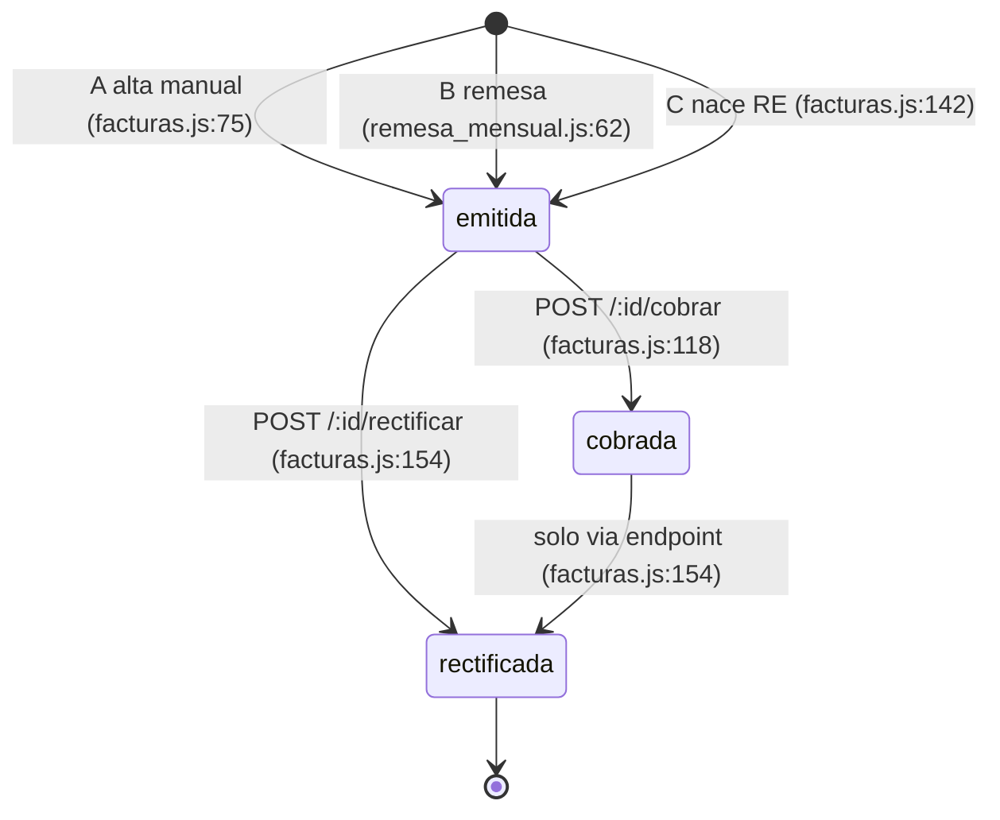

# Ciclo de vida de una factura en GesFact

Documento de solo lectura de la fase «documentar y proteger». No se ha modificado
código, datos ni dependencias (Constitución, Principios I, III y IV). Los hallazgos
se registran, no se corrigen (Principio III).

## 0. Método y convenciones

- **Evidencia** (Principio II): `fichero:línea` = código leído con numeración;
  **BD** = consulta de solo lectura a `datos/gesfact.db` (`sqlite3 -readonly`);
  **Entorno** = salida de un comando ejecutado aquí con funciones puras
  (`services/calculo.js`, `lib/util.js`), sin tocar la BD.
- **SUPOSICIÓN** = no verificable con el código/datos; va a «Preguntas abiertas» (§8).
- Los números de línea son los del estado actual del repositorio.

## 1. ¿Cuántos caminos de creación existen? (comprobado)

Se buscaron todas las escrituras en `facturas`:

```
grep -rnE "INSERT INTO (facturas|lineas|contadores)|UPDATE (facturas|contadores)|DELETE" ...
```

| # | Camino | `INSERT INTO facturas` | Evidencia |
|---|--------|------------------------|-----------|
| A | Creación manual desde la web (`POST /facturas/nueva`) | serie `FA` | `routes/facturas.js:74` |
| B | Remesa mensual de contratos (`node scripts/remesa_mensual.js AAAA-MM`) | serie `FA` | `scripts/remesa_mensual.js:61` |
| C | Rectificación (`POST /facturas/:id/rectificar`) | serie `RE` | `routes/facturas.js:141` |
| — | Carga inicial de datos semilla | serie `FA`/`RE` | `db.js:123` |

Conclusiones comprobadas:

- Hay **exactamente tres caminos operativos** (A, B, C). El cuarto sitio con
  `INSERT INTO facturas` (`db.js:123`, dentro de `cargarDatosIniciales`) solo se
  ejecuta si `clientes` está vacía (`db.js:83-87`); no es un camino de negocio.
- **No existe ningún `DELETE`** sobre ninguna tabla (la búsqueda no devuelve ninguno
  en código de producto). Coherente con `lib/numeracion.js:3-6`.
- **No hay camino "baja de contrato → factura"**. `POST /contratos/:id/baja` solo
  actualiza `contratos.fecha_baja` y *muestra* un importe de prorrateo; la factura
  la emite «a mano» administración (`routes/contratos.js:28-30`, `:35`, `:39-40`).
  Se documenta en §6 porque interacciona con B.
- `POST /facturas/:id/cobrar` no crea facturas; solo cambia estado (§5).

## 2. Piezas compartidas

| Pieza | Qué hace | Evidencia |
|-------|----------|-----------|
| `services/calculo.js: calcularFactura(lineas, cliente)` | Cálculo de líneas, descuento por volumen, totales | `calculo.js:48-88` |
| `services/calculo.js: calcularLinea` | Base, IVA y recargo de una línea, redondeados | `calculo.js:26-34` |
| `services/calculo.js: porcentajeDescuento` | 5 % si base > 5000; 2 % si base > 1000; si no, 0 | `calculo.js:39-43` |
| `services/calculo.js: recargoPara` | Recargo según tipo de IVA (21→5,2; 10→1,4; 4→0,5; 18/16→4; 8/7→1) | `calculo.js:12-23` |
| `lib/util.js: redondear2` | `Math.round(x*100)/100` | `util.js:5-7` |
| `lib/util.js: sumarDias` | Suma días a `YYYY-MM-DD` (vencimiento) | `util.js:20-26` |
| `lib/numeracion.js: siguienteNumero(serie, cb)` | Reserva el siguiente número de serie/año | `numeracion.js:14-36` |
| `lib/numeracion.js: formatear` | `SERIE-AAAA-NNNNNN` (6 dígitos) | `numeracion.js:38-42` |
| `db` (instancia única SQLite) | Persistencia | `db.js:15`, `:183-184` |

### 2.1 Numeración (común a A, B y C), paso a paso

1. `anyo = new Date().getFullYear()` — año **del reloj del sistema**, no de la fecha de
   la factura (`numeracion.js:15`).
2. `SELECT ultimo FROM contadores WHERE serie=? AND anyo=?` (`:16`).
3. Si no hay fila: `INSERT INTO contadores (serie,anyo,ultimo) VALUES (?,?,0)` (`:20`)
   y se reserva desde 0.
4. `reservar`: `nuevo = ultimo + 1` y `UPDATE contadores SET ultimo = ?` (`:31-32`).
5. Se devuelve `formatear(serie, anyo, nuevo)` (`:34`), p. ej. `FA-2026-000109`.

Hechos relevantes:

- La lectura (paso 2) y la escritura (paso 4) son **dos sentencias independientes**,
  sin transacción. El comentario reconoce la colisión de enero 2021 y «creo» que no
  volvió a pasar (`numeracion.js:8-10`).
- El contador se **incrementa antes** de grabar la factura en los tres caminos. Si el
  `INSERT INTO facturas` posterior falla, el número queda consumido (hueco). Evidencia:
  orden de llamadas en `facturas.js:71-74`, `:138-141`, `remesa_mensual.js:57-61`.
  (Que ese hueco sea legalmente problemático es SUPOSICIÓN; ver §8.)
- **BD**: `contadores` = `FA|2026|108`, `RE|2026|1`; los números máximos grabados son
  `FA-2026-000108` y `RE-2026-000001`, coherentes con los contadores.

---

## 3. Camino A — Creación manual desde la web

### 3.1 Entradas

Formulario `views/factura_nueva.ejs:3-27`, enviado por `POST /facturas/nueva`:
`cliente_id`, `fecha` (opcional; `<input type="date">`), arrays `desc[]`, `cant[]`,
`precio[]`, `iva[]` (6 filas fijas, `:13`), y `obs`. El IVA solo ofrece 21/10/4
(`:18`). `public/js/factura.js:4-14` autorrellena precio e IVA desde el artículo
elegido (solo conveniencia de pantalla).

### 3.2 Secuencia (con evidencia)

Módulos atravesados, en orden: `server.js` (monta `/facturas`, `:41`) →
`routes/facturas.js` → `services/calculo.js` → `lib/util.js` → `lib/numeracion.js`
→ `db.js` → `services/email.js`.

| Paso | Qué ocurre | Evidencia |
|------|-----------|-----------|
| 1 | `clienteId = parseInt(cliente_id)`; `fecha = req.body.fecha \|\| util.hoy()` | `facturas.js:43-44` |
| 2 | Lee el cliente (`SELECT * FROM clientes WHERE id=?`). Si no existe → 400 «Cliente no valido». **No se comprueba `activo`.** | `:46-47` |
| 3 | Monta líneas: salta filas con `desc` vacío; `cantidad`/`precio` con `parseFloat` cambiando `,`→`.`; `tipoIva = parseInt` | `:50-63` |
| 4 | Sin líneas → 400 «La factura no tiene lineas» | `:64` |
| 5 | **Cálculo**: `calculo.calcularFactura(lineas, cliente)` | `:66` |
| 6 | Vencimiento: `dias = cliente.dias_pago \|\| config.VENCIMIENTO_DIAS` (30, `config.js:40`); `util.sumarDias(fecha, dias)` | `:68-69` |
| 7 | **Número**: `numeracion.siguienteNumero('FA', ...)` | `:71` |
| 8 | **Graba cabecera** `facturas` (estado `'emitida'`, `rectifica_a` no se informa → NULL) | `:74-76` |
| 9 | `facturaId = this.lastID` | `:79` |
| 10 | **Graba líneas** `lineas`, una `INSERT` por cada `calc.lineas`, lanzadas **en paralelo** con contador `pendientes` | `:83-98` |
| 11 | Al terminar la última: si hubo error → 500; si no, `email.enviarFactura(...)` (no-op) y `redirect /facturas/:id` | `:91-95` |

### 3.3 Cálculos aplicados (función exacta)

Todo en `calculo.calcularFactura` (`calculo.js:48-88`):

1. `conRecargo = cliente.recargo_equivalencia == 1` (`:49`).
2. Pasada 1: por línea `calcularLinea(cantidad, precio, tipoIva, conRecargo)`;
   `baseBruta = redondear2(baseBruta + c.base)` (`:54-58`).
3. `dto = porcentajeDescuento(baseBruta)` (`:60`); comparación **estricta** `>`
   (`calculo.js:40-41`): 1000,00 exactos no descuentan.
4. Pasada 2: si `dto > 0`, `precioConDto = redondear2(precio*(100-dto)/100)` (`:68-70`)
   y se **recalcula la línea** con ese precio (`:71`). La línea guardada lleva el
   **precio ya descontado** (`:75`).
5. Acumula `base`, `iva`, `recargo` redondeando tras cada línea (`:81-83`);
   `total = redondear2(base+iva+recargo)` (`:86`).
6. Dentro de `calcularLinea`: `base = redondear2(cant*precio)`;
   `cuotaIva = redondear2(base*tipoIva/100)`; `cuotaRecargo = redondear2(base*recargoPara(tipoIva)/100)`
   solo si `conRecargo` (`calculo.js:27-32`).

**Entorno**: `calcularFactura([{cantidad:1,precio:1500,tipoIva:21}], sin recargo)` →
`descuentoPct:2`, `precio:1470`, `base:1470`, `iva:308.7`, `total:1778.7`.

Texto de observaciones: `obs` + `' Descuento volumen N% aplicado'` si `descuentoPct>0`
(`facturas.js:76`). **BD**: `FA-2026-000105` lleva exactamente «Descuento volumen 2%
aplicado».

### 3.4 Qué se graba y en qué orden

1. `contadores` (lectura + posible `INSERT` + `UPDATE`) — `numeracion.js:16-32`.
2. `facturas` (1 fila) — `facturas.js:74`.
3. `lineas` (N filas, orden **no garantizado** entre ellas por ser paralelas) —
   `facturas.js:85-98`. El detalle ordena por `id` (`:109`).

Campos de cabecera: `numero`, `serie='FA'`, `cliente_id`, `fecha`, `vencimiento`,
`base`, `iva`, `recargo`, `total`, `estado='emitida'`, `observaciones`.

### 3.5 Estado resultante

Siempre `emitida` (literal en `facturas.js:75`). Cambios posteriores: §5.

### 3.6 Puntos débiles observados (se registran, no se corrigen)

- **Sin transacción**: cabecera y líneas son sentencias separadas; si falla una línea
  la cabecera ya está grabada y la respuesta es 500 (`facturas.js:92`). El propio
  comentario lo admite (`:81-82`). Riesgo.
- **Entradas no validadas**: **Entorno**: con `cantidad` = NaN, `calcularFactura`
  devuelve `base:null, iva:null, total:null`. La cabecera tiene `base REAL NOT NULL`
  (`db.js:57-60`), por lo que el `INSERT` debería fallar (500) **tras haber consumido
  ya el número** (§2.1). El fallo concreto de SQLite no se ha ejecutado; SUPOSICIÓN.
- `fecha` no se valida ni se cruza con el año de numeración (§2.1, §6.5).
- Si `desc` tiene valor pero `precio` está vacío, `parseFloat('')` = NaN (mismo caso).

---

## 4. Camino B — Remesa mensual de contratos

### 4.1 Entradas

Línea de comandos: `node scripts/remesa_mensual.js AAAA-MM` (`remesa_mensual.js:3`,
`:14-18`; validada con `/^\d{4}-\d{2}$/`). Recordatorio en pantalla de inicio:
`views/index.ejs:9-10`. Datos de entrada: tablas `contratos` y `clientes`.
**No pasa por `server.js` ni por Express**: es un proceso aparte que abre la misma BD
(`remesa_mensual.js:9`, `db.js:15`).

### 4.2 Secuencia (con evidencia)

Módulos, en orden: `scripts/remesa_mensual.js` → `lib/util.js` (`diasDelMes`) →
`db.js` (`inicializar`) → `services/calculo.js` → `lib/numeracion.js` →
`lib/util.js` (`sumarDias`) → `db.js`. **No** usa `services/email.js`
(no aparece en sus `require`, `:9-12`).

| Paso | Qué ocurre | Evidencia |
|------|-----------|-----------|
| 1 | `primerDia = mes+'-01'`; `ultimoDia = mes+'-'+util.diasDelMes(...)` | `:20-21` |
| 2 | `db.inicializar` (crea tablas si faltan; si `clientes` está vacía carga datos semilla) | `:23`, `db.js:83-87` |
| 3 | Selecciona contratos: `fecha_alta <= ultimoDia AND (fecha_baja IS NULL OR fecha_baja >= primerDia)`, con `JOIN clientes` (trae `nombre`, `recargo_equivalencia`, `dias_pago`). **No filtra `clientes.activo`** ni facturas ya existentes | `:26-29` |
| 4 | Si no hay contratos → mensaje y `exit(0)` | `:31` |
| 5 | Procesa contratos **secuencialmente** (`procesarSiguiente`, recursivo por callbacks) | `:33-41` |
| 6 | **Prorrateo propio** (§4.3) | `:45-51` |
| 7 | Construye **una sola línea** y llama a `calculo.calcularFactura` | `:53-55` |
| 8 | **Número**: `numeracion.siguienteNumero('FA', ...)` | `:57` |
| 9 | `fecha = ultimoDia`; `venc = util.sumarDias(fecha, co.dias_pago \|\| 30)` | `:59-60` |
| 10 | **Graba cabecera** (`estado='emitida'`, observaciones `'Remesa '+nombreMes`) | `:61-62` |
| 11 | **Graba la línea** (`calc.lineas[0]`) | `:65-68` |
| 12 | Imprime número, cliente y total; pasa al siguiente. Al acabar, `process.exit(0)` | `:71-72`, `:37-40` |

Cualquier error en pasos 3, 8, 10 u 11 → `console.error` + `process.exit(1)` **sin
deshacer** lo ya grabado (`:30`, `:58`, `:64`, `:70`).

### 4.3 Cálculos aplicados (función exacta)

**Prorrateo — código propio en el script, NO `calculo.calcularProrrateo`**
(`remesa_mensual.js:45-51`):

```
desde       = max(co.fecha_alta, primerDia)
hasta       = min(co.fecha_baja, ultimoDia)      (si hay baja dentro del mes)
diasMes     = util.diasDelMes(primerDia)         // 28..31 reales
diasServicio= d2 - d1 + 1
importe     = util.redondear2(co.cuota / diasMes * diasServicio)
```

Se aplica **siempre**, también a meses completos (cuota/diasMes*diasMes). Sufijo de
la descripción: `' (N dias)'` si `diasServicio < diasMes`, si no `' (<mes> <año>)'`
(`:53`).

Después: `calculo.calcularFactura([{cantidad:1, precio:importe, tipoIva:co.tipo_iva}],
{recargo_equivalencia: co.recargo_equivalencia})` (`:54-55`) — mismas reglas de §3.3
(incluido el descuento por volumen, que solo se activaría si `importe > 1000`;
no comprobado en datos: no hay contratos así. **BD**: 4 contratos, cuotas 60–145 €).

Consecuencia no evidente: si hubiera descuento, la línea saldría con el precio
descontado y **sin** el texto «Descuento volumen» en observaciones, porque el script
escribe `'Remesa '+nombreMes` (`:62`) mientras el camino A sí lo añade (`facturas.js:76`).
Deducción del código, no reproducida.

### 4.4 Qué se graba y en qué orden

Por cada contrato, en este orden: `contadores` → `facturas` (1) → `lineas` (1)
(`:57`, `:61`, `:67`). Una factura por contrato (no por cliente): un cliente con dos
contratos recibe dos facturas.

Campos: `serie='FA'`, `fecha = ultimoDia` (último día del mes facturado), `estado='emitida'`,
`rectifica_a` NULL.

### 4.5 Estado resultante

Siempre `emitida` (`remesa_mensual.js:62`).

### 4.6 Puntos débiles observados

- **No es idempotente**: no hay ninguna consulta a `facturas` antes de emitir
  (`:26-29` solo lee `contratos`/`clientes`); lanzar dos veces el mismo mes genera
  facturas duplicadas. **BD** relacionada: `FA-2026-000106` tiene
  «Remesa abril. ERROR cuota duplicada» y fue rectificada con `RE-2026-000001`
  (`rectifica_a='FA-2026-000106'`). Que la causa fuera una doble ejecución es
  SUPOSICIÓN.
- Sin transacción por contrato y salida brusca con `exit(1)`: una remesa puede quedar
  a medias (algunos contratos facturados, otros no) y no hay registro de cuáles.
- **BD vs script**: `FA-2026-000101` («Remesa enero») y `FA-2026-000108` («Remesa
  mayo») tienen 4 y 3 líneas, pero el script solo graba **1 línea** (`:66-68`).
  Esas facturas llevan, pues, líneas añadidas por otro medio (probablemente editadas
  a mano en la BD). SUPOSICIÓN; pregunta abierta.
- Corre en proceso aparte sobre el mismo fichero SQLite que el servidor; no se ha
  analizado el comportamiento de bloqueos si coinciden (no verificado).

---

## 5. Camino C — Rectificación de una factura existente

### 5.1 Entradas

`POST /facturas/:id/rectificar` con campo opcional `motivo`
(`facturas.js:129`, `:143`; formulario en `views/factura_detalle.ejs:49-51`). El botón
solo se pinta si `f.estado === 'emitida' && f.serie === 'FA'` (`factura_detalle.ejs:47`).
**Esa restricción es solo de pantalla**: el endpoint admite más (ver 5.6).

### 5.2 Secuencia (con evidencia)

Módulos: `routes/facturas.js` → `lib/numeracion.js` → `lib/util.js` (`hoy`) → `db.js`.
**No** pasa por `services/calculo.js`: el comentario lo exige («aquí NO se recalcula
nada… espejo exacto», `facturas.js:127-128`).

| Paso | Qué ocurre | Evidencia |
|------|-----------|-----------|
| 1 | Lee la factura original `f` (+ nombre de cliente). No existe → 404 | `:130-131` |
| 2 | Rechaza si `f.estado === 'rectificada'` («Ya esta rectificada») | `:132` |
| 3 | Rechaza si `f.serie === 'RE'` («No se rectifica una rectificativa») | `:133` |
| 4 | Lee las líneas originales (`SELECT * FROM lineas WHERE factura_id=?`) | `:135` |
| 5 | **Número**: `numeracion.siguienteNumero('RE', ...)` | `:138` |
| 6 | **Graba cabecera** RE: `fecha = util.hoy()`, `vencimiento = null`, `base/iva/recargo/total` = original con signo `-`, `estado='emitida'`, `rectifica_a = f.numero`, observaciones `'Rectifica '+f.numero+'. '+motivo` | `:141-143` |
| 7 | `rectId = this.lastID` | `:146` |
| 8 | **Graba líneas** invertidas, en paralelo: descripción `'Rectificación: '+...`, `cantidad` negada, `precio` **igual** (positivo), `base`, `cuota_iva`, `cuota_recargo` negadas | `:147-150` |
| 9 | Al terminar la última línea: `UPDATE facturas SET estado='rectificada' WHERE id = f.id` | `:153-154` |
| 10 | `redirect /facturas/:rectId` | `:155` |

### 5.3 Cálculos aplicados

Ninguno de `calculo.js`. Solo negación aritmética (`-f.base`, `-f.iva`, `-f.recargo`,
`-f.total`, `-l.cantidad`, `-l.base`, `-l.cuota_iva`, `-l.cuota_recargo`;
`facturas.js:142`, `:150`). **BD**: `RE-2026-000001` = −101,61 / −20,62 / 0 / −122,23,
espejo exacto de `FA-2026-000106`; sus líneas tienen `cantidad` −1 y −0,97 con precio
positivo.

### 5.4 Qué se graba y en qué orden

`contadores` (serie **RE**) → `facturas` (RE, nueva) → `lineas` (N, en paralelo) →
`UPDATE facturas` de la original a `rectificada`. La original **no se borra ni se
modifica en importes** (solo `estado`).

### 5.5 Estado resultante

- Rectificativa: `emitida` (`facturas.js:142`). **BD**: `RE-2026-000001|emitida`.
- Original: `rectificada` (`:154`). **BD**: `FA-2026-000106|rectificada`.

### 5.6 Puntos débiles observados

- **Orden de la marca**: la original solo pasa a `rectificada` al final; si algo falla
  antes (cabecera RE grabada, una línea falla…) puede existir RE sin que la original
  quede marcada. Los callbacks de líneas **ignoran errores** (`function () {...}`,
  `facturas.js:151`).
- **Factura sin líneas**: si `lineas.length === 0`, el `forEach` no ejecuta nada y
  nunca se llega al `UPDATE` ni al `redirect` (`:147-159`): la petición queda sin
  respuesta y la original sin marcar, aunque la RE ya está grabada. Deducción del
  código; no reproducido.
- **Sin protección contra doble clic/concurrencia**: el control de estado (`:132`) es
  lectura previa; dos peticiones simultáneas podrían crear dos RE. No reproducido.
- **Endpoint más permisivo que la pantalla**: el servidor acepta rectificar una `FA`
  en estado `cobrada` (solo rechaza `rectificada` y serie `RE`, `:132-133`), cosa que
  la pantalla no ofrece (`factura_detalle.ejs:47`). En ese caso la original pasa de
  `cobrada` a `rectificada` (`:154`, `UPDATE` sin condición de estado).
- La rectificativa nace con `vencimiento` NULL y fecha = hoy (puede caer en otro año
  que la original; §6.5).
- El informe de IVA cuadra «solo» porque suma líneas con signo
  (`routes/informes.js:21-25`).

---

## 6. Puntos donde dos caminos hacen «lo mismo» con código distinto

| # | Qué hacen | Camino A | Camino B | Camino C | Diferencia observable |
|---|-----------|----------|----------|----------|----------------------|
| 6.1 | **Prorrateo de un periodo parcial de contrato** | No existe | `remesa_mensual.js:45-51` (días **reales** del mes) | No | Ver abajo (funciones: B y `calcularProrrateo` de `/contratos/:id/baja`) |
| 6.2 | **Cálculo de vencimiento por defecto** | `cliente.dias_pago \|\| config.VENCIMIENTO_DIAS` (`facturas.js:68`) | `co.dias_pago \|\| 30` literal (`remesa_mensual.js:60`) | `null` (`facturas.js:142`) | Mismo valor hoy (30, `config.js:40`) pero si cambia `config` solo A lo sigue |
| 6.3 | **Texto de descuento por volumen en observaciones** | Añade «Descuento volumen N% aplicado» (`facturas.js:76`) | No lo añade (`remesa_mensual.js:62`) | N/A | Misma función de cálculo, distinta trazabilidad |
| 6.4 | **Grabación de líneas** | `forEach` + INSERT en paralelo, comprueba errores (`facturas.js:85-98`) | INSERT secuencial de 1 línea, error → `exit(1)` (`remesa_mensual.js:67-70`) | `forEach` + INSERT en paralelo, **ignora errores** (`facturas.js:148-151`) | Tres tratamientos de error distintos para la misma tarea |
| 6.5 | **Año de la numeración vs fecha de la factura** | `fecha` libre, año del reloj (`numeracion.js:15`) | `fecha = ultimoDia` del mes de entrada; año del reloj | `fecha = hoy` | Remesa de `2026-12` lanzada en enero 2027 daría `FA-2027-…` con fecha `2026-12-31` (deducción de `remesa_mensual.js:59` + `numeracion.js:15`; no ejecutado) |
| 6.6 | **Aviso al cliente por email** | Llama a `email.enviarFactura` (no-op) (`facturas.js:93`) | No llama | No llama | Solo A deja el aviso «pendiente de enviar a mano» en consola (`email.js:26-28`) |
| 6.7 | **Importes de la cabecera** | `calcularFactura` | `calcularFactura` | Negación de lo grabado | A y B comparten código (bien); C es deliberadamente distinto (`facturas.js:127-128`) |
| 6.8 | **Reserva de número** | `siguienteNumero('FA')` | `siguienteNumero('FA')` | `siguienteNumero('RE')` | Mismo código; solo cambia la serie |
| 6.9 | **Fecha por defecto** | `util.hoy()` si falta (`facturas.js:44`) | último día del mes | `util.hoy()` | — |

### 6.1 Detalle: dos prorrateos incompatibles

- **Camino B (remesa)** divide por los días reales del mes: `redondear2(cuota / diasMes * diasServicio)`
  (`remesa_mensual.js:51`).
- **`calcularProrrateo`** (usada solo en `/contratos/:id/baja`, `routes/contratos.js:39`;
  única llamada según `grep`) divide **siempre por 30** y limita días a 30 (`calculo.js:95-102`).
  La Constitución lo declara «a lo comercial» y fija su mantenimiento (Principio I).

**Entorno** (cuota 90 €, alta/prorrateo del 16 al fin de mes):

| Mes | Remesa (días reales) | `calcularProrrateo` (30 fijos) |
|-----|---------------------|-------------------------------|
| Junio (30 días) | 45,00 | 45,00 |
| Julio (31 días) | 46,45 (= 90/31×16) | 48,00 |

Interacción con la baja: tras `POST /contratos/:id/baja`, el contrato sigue entrando en
la remesa de ese mes mientras `fecha_baja >= primerDia` (`remesa_mensual.js:28`), con el
importe de la remesa, mientras la pantalla de baja enseña otro importe y dice que
administración factura «a mano» con ese importe (`contratos.js:28-30`). El riesgo de
doble facturación del último mes (manual + remesa) y de importes distintos es una
deducción del código; **cómo trabaja realmente administración es SUPOSICIÓN** (§8).

### 6.2 Detalle: la fecha del vencimiento depende de la zona horaria

`util.sumarDias` interpreta `new Date('YYYY-MM-DD')` como UTC y lee la fecha en hora
local (`util.js:21-24`). Lo usan A (`facturas.js:69`) y B (`remesa_mensual.js:60`).
**Entorno**: con `TZ=Europe/Madrid`, `sumarDias('2026-01-31',30)` = `2026-03-02`
(coincide con **BD** `FA-2026-000101`); en esta máquina (offset local +180 min, UTC-3,
sin `TZ`) devuelve `2026-03-01`. El TODO de marzo de 2019 (`util.js:18-19`) apunta al
mismo síntoma. No es una diferencia entre caminos, pero afecta a los dos por igual.

---

## 7. Estados de la factura: valores, transiciones y responsables

### 7.1 Valores

`estado TEXT NOT NULL DEFAULT 'emitida'` con comentario «emitida / cobrada / rectificada»
(`db.js:61`). **No hay `CHECK`**: el valor lo restringe solo el código. **BD** (`GROUP BY
estado, serie`): `cobrada|FA|4`, `emitida|FA|3`, `emitida|RE|1`, `rectificada|FA|1`.

### 7.2 Todas las escrituras de `estado` (comprobado con `grep`)

| Transición | Quién la dispara | Código | Condición |
|------------|-----------------|--------|-----------|
| (nada) → `emitida` | A: alta manual | `facturas.js:75` | siempre |
| (nada) → `emitida` | B: remesa | `remesa_mensual.js:62` | siempre |
| (nada) → `emitida` (serie RE) | C: rectificativa | `facturas.js:142` | siempre |
| `emitida` → `cobrada` | `POST /facturas/:id/cobrar` (botón «Marcar cobrada», solo FA emitida en pantalla, `factura_detalle.ejs:47-48`) | `facturas.js:118` | `WHERE id=? AND estado='emitida'` |
| cualquier distinto de `rectificada` → `rectificada` | Cierre de `POST /facturas/:id/rectificar` | `facturas.js:154` | `WHERE id=?` (sin condición de estado) |

Notas:

- **No existe transición de salida** desde `rectificada` ni desde `cobrada` salvo
  `cobrada → rectificada` (vía endpoint, no vía pantalla). No hay "descobrar".
- `POST /cobrar` **no comprueba la serie**: una `RE` en estado `emitida` aceptaría el
  `UPDATE` si se llama al endpoint directamente (la pantalla no ofrece el botón en RE,
  `factura_detalle.ejs:47`). Deducción del código; no ejecutado.
- **Sin autenticación**: cualquiera con acceso HTTP a la red interna puede cambiar
  estados (`AGENTS.md`; no hay middleware de auth en `server.js:16-42`).
- Los estados aparecen en: listado y filtro (`facturas.js:18-19`, `facturas.ejs:20`),
  cuadro de inicio —solo `emitida` y serie `FA` para el importe pendiente
  (`server.js:23-24`)— y CSV de gestoría (`informes.js:36`, `:45`). Una `RE`
  `emitida` **cuenta** en «pendientes» (`server.js:23`, sin filtro de serie) pero no en
  el importe (`:24`): inconsistencia del panel (deducción del código).

### 7.3 Diagrama



### 7.4 Ciclo completo (ejemplo real en BD)

`FA-2026-000106` (remesa abril, error) → `emitida` → rectificada por
`RE-2026-000001` (`rectifica_a='FA-2026-000106'`, fecha 2026-05-06) → original
`rectificada`; se emite nueva `FA-2026-000107` («Sustituye a FA-2026-000106») por
camino A. No existe enlace formal entre la RE y la sustituta: solo texto libre en
`observaciones`.

---

## 8. Preguntas abiertas al negocio (SUPOSICIONES)

1. ¿La factura duplicada `FA-2026-000106` se debió a lanzar dos veces la remesa de abril?
2. ¿Quién añadió las líneas extra a `FA-2026-000101` y `FA-2026-000108` (el script solo
   graba una) y cómo?
3. ¿Se factura el último mes de un contrato dado de baja por la remesa, a mano, o por
   ambos? ¿Qué importe es el vigente: 30 días fijos o días reales?
4. ¿Es legalmente aceptable un hueco de numeración si falla el alta tras reservar
   número (§2.1)?
5. ¿Qué año debe llevar el número de una remesa de diciembre lanzada en enero?
6. ¿Se debe poder rectificar una factura `cobrada`? (la pantalla no; el endpoint sí).
7. ¿En qué zona horaria corre el servidor de la oficina? (afecta a `sumarDias`).

## 9. Qué NO se ha podido verificar

- No se han ejecutado los caminos A, B y C contra una copia de la BD (no se escribió
  en `datos/gesfact.db`, Constitución, «Datos sensibles»). Todo lo dicho sobre
  comportamiento en ejecución sale de leer el código, de funciones puras ejecutadas
  en memoria y de consultas de solo lectura.
- Condiciones de carrera, bloqueos SQLite entre servidor y script, y los fallos
  concretos ante entradas NaN: deducidos, no reproducidos.
